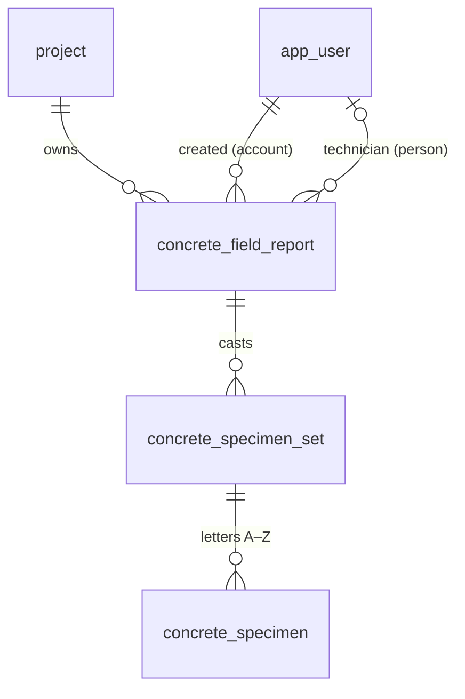
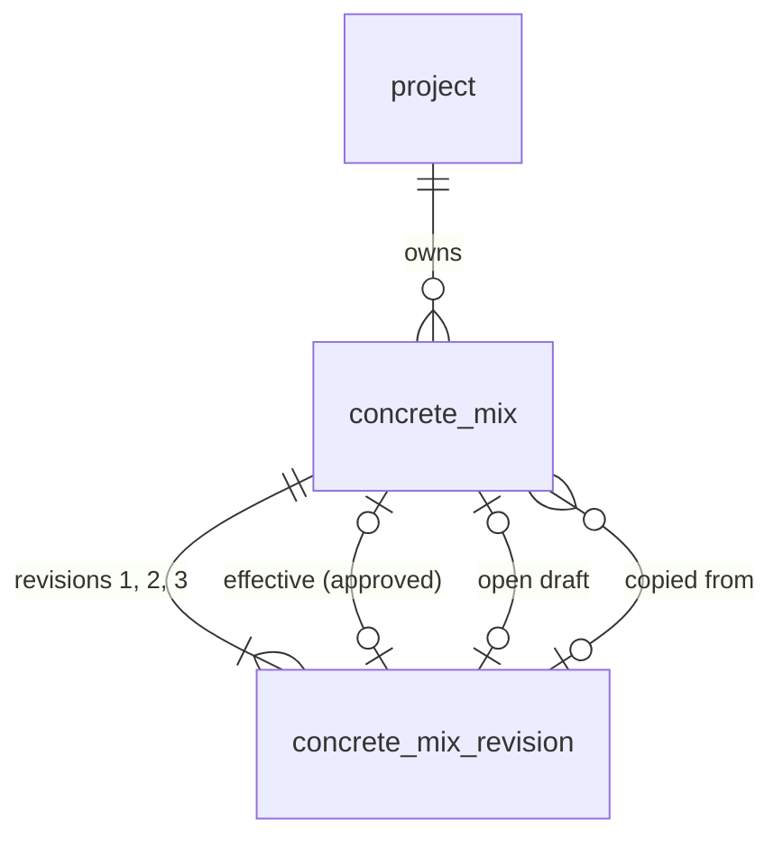

# Concrete domain (V2)

Concrete field reports, specimen sets and specimens: a domain separate from geotechnical storage
units. Requirements: Notion "V2 Concrete — Specification" (decisions CD-xx) and the Concrete
Development Board (cards MM-V2-Cxx). Permissions: [permissions.md](permissions.md#concrete-permission-contract-mm-ao08).

**Status:** the aggregate roots exist in the database (MM-V2-C01, migration
`0015_concrete_domain.sql`) and as shared contracts (`packages/shared/src/concrete.ts`, fixtures in
`concrete-fixtures.ts`); project settings and the concrete Lab Manager grant (C02, `0016`); project
mixes with approval and specification history (C03, `0017`); the equipment register (C27, `0018`);
field-report detail, readings and the draft APIs (C04, `0019`, below); specimen sets, age
assignments, schedule snapshots and casting corrections (C05, `0020`, below); the daily lab
worklist and authorized rescheduling (C22, `0022`, below; Lab Testing → Concrete breaks). No other
screen, offline store, allocator, submission, review, issuance or calculation reads or writes
reports, sets or specimens yet.

## A deliberate new domain

Concrete specimens are individual records, and later cards receive them one by one (C06: one mass
per specimen). That is intentional and applies to concrete only. Geotechnical receiving is
unchanged: per storage unit, with one SAMPLE#/DEPTH summary per test hole and no individual sample
inventory (CLAUDE.md "Never"). Concrete identity never uses storage-unit IDs
(`BKT-`/`ST-`/`CRE-`/`CT-`), their annual counters, receipts or label printing, and migration 0015
changes none of those tables (proven in `schema-concrete.test.ts`, AC1).

## Records

| Table                               | What it is                                                                     |
| ----------------------------------- | ------------------------------------------------------------------------------ |
| `concrete_field_report`             | One sampled load / test (CD-13). Zero sets is valid.                           |
| `concrete_specimen_set`             | Specimens cast from that load. The schema sets no cap on sets per report.      |
| `concrete_specimen`                 | One specimen, lettered A–Z in its set: at most 26 (CD-10), no fixed row count. |
| `concrete_specimen_identity` (view) | A specimen's temporary and permanent ID: its set's plus its letter.            |

Every table has `id` (UUID), `project_id`, `version` (optimistic concurrency, starts at 1),
`created_at` and `updated_at`. The API sets `version`/`updated_at`, as for other tables.

### Rules the database enforces (each proven in `apps/api/src/db/schema-concrete.test.ts`)

- **Same project down the tree.** A set references `(project_id, field_report_id)` and a specimen
  `(project_id, set_id)`, so a child can never sit under a parent in another project (AC2). A
  report's project correction cascades to its sets and specimens; a set or specimen can't change
  project on its own.
- **Internal UUIDs never change** (trigger), so a client may generate them offline and a retried
  sync of the same record is the same row.
- **Aliases (spec page 3).** A set's `temporary_id` (`TMP-<device>-<counter>`, CD-06; unique
  everywhere, since device codes are never reused) and `permanent_id` + `permanent_number`
  (`YY-NN` / `GYY-NN`, CD-07/CD-11) are nullable and attached later; once attached they never
  change or clear (AC4). A draft holds neither and consumes nothing (AC3).
- **One counter per project for all materials.** `permanent_number` is unique per project
  whatever the year or `G` prefix; set numbers may repeat across projects. The ID's number part
  must equal `permanent_number` with at least two digits (`27-03`, not `27-3` or `27-003`).
- **Numbers stay in the register (CD-08).** A numbered set can't be deleted, can't change project,
  and its specimens can't be deleted or re-lettered. Unnumbered draft sets and specimens may be.
  Sets and specimens can't be truncated.
- **Attribution vs authority.** `created_by_user_id` is the signed-in account (may be LAB);
  `technician_user_id` is the person credited, checked to be an active personal or test account
  when set (a later disable keeps the credit). Optional while a draft.

## Four status dimensions

Never folded into one value (spec page 1). Contracts in `packages/shared/src/concrete.ts`:

| Dimension          | Where                                                                                                        | Values                                                                                                                                                                        |
| ------------------ | ------------------------------------------------------------------------------------------------------------ | ----------------------------------------------------------------------------------------------------------------------------------------------------------------------------- |
| Draft completeness | computed each time, never stored (`concreteDraftCompletenessSchema`)                                         | `complete` + `missingRequired` field paths. Missing draft data is `null`, never 0 or No.                                                                                      |
| Workflow state     | `workflow_state`, `ready_to_submit_at`, `submitted_at` (`concreteWorkflowSchema`)                            | `draft`, `ready_to_submit`, `submitted`, `returned`, `reviewed`, `void`. Ready to submit needs its intent time; `submitted_at` is set exactly when submitted.                 |
| Sync               | device only (`concreteDeviceSyncStatusSchema`); server acknowledgment (`concreteReportAcknowledgmentSchema`) | `saved_on_device`, `pending_upload`, `accepted`, `needs_attention`, `conflict`; the acknowledgment names the accepted version. Attachments are acknowledged separately (C15). |
| Issuance           | `issue_count`, `last_issued_*` (`concreteIssuanceSchema`)                                                    | `not_issued` / `issued`, the count and the latest issue (version, time, issuer), all or none.                                                                                 |

Specimen lifecycle (Expected … Disposed) and strength-report status are further dimensions owned by
later cards (below); they are not modelled yet.

## Field ownership

C01 owns only the columns above. Each later card adds its fields in its own migration and extends
the shared contracts; none may repurpose a C01 column.

| Card | Owns                                                                                                                                                           |
| ---- | -------------------------------------------------------------------------------------------------------------------------------------------------------------- |
| C02  | Project concrete settings, the concrete Lab Manager grant, reusable concrete policy                                                                            |
| C03  | Mixes, approval and specification history                                                                                                                      |
| C04  | Field-report detail (project/load, location and times, field tests, material, notes, snapshots) and draft APIs; the completeness field list                    |
| C05  | Set and specimen detail (mould, per-specimen age / HOLD assignment, dates), schedule snapshots, Void columns, casting corrections                              |
| C06  | **Pickup, initial curing and receiving detail** (pickup time and collector, curing min/max, receiving time and person, mass per specimen, marker confirmation) |
| C07  | **Numerical test results**, tester attribution and correction history                                                                                          |
| C09  | Report versions and issuance lifecycle (writes the issuance columns; decides what "Revised" shows)                                                             |
| C12  | Device registration and the temporary-ID counter (device codes)                                                                                                |
| C15  | Attachments and their acknowledgment                                                                                                                           |
| C17  | Sync protocol, acknowledgment and conflicts; project placeholder matching (CD-24)                                                                              |
| C22  | Daily lab worklist (derived, stores nothing) and specimen reschedules with reason and history                                                                  |
| C18  | Permanent set-number allocator (project counter row, locked in the accepting transaction; never a sequence) and Void                                           |
| C19  | Ready to submit and server submission (writes the workflow columns)                                                                                            |
| C24+ | Strength calculation, failed-test workflow, HOLD and disposal                                                                                                  |
| C27  | Equipment register: the testing machine and air meters, calibration history and the equipment flag rule                                                        |

## Project settings and authority (C02)

- **Settings** (`GET`/`PATCH /api/projects/:projectId/concrete-settings`, contracts in
  `packages/shared/src/concrete-settings.ts`): default specimen ages (7 / 28 / 28 / HOLD), HOLD
  duration (56 days from casting) and whether issued reports include the testing machine's
  make/model and calibration dates (unset until chosen). They are defaults for sets created later:
  the set/specimen card (C05) copies them onto a new set when it assigns ages, and nothing rewrites
  an existing set, schedule or issued report when they change. The 56 days is a duration; later
  cards compute the date from casting. Kyle will review the full settings list later; this list is
  not exhaustive.
- **Reviewers** are not a setting: they are MISC-08 reviewer assignments for `concrete_field` /
  `concrete_strength`, effective only with eligibility, accepted team membership and the lead's
  approval. A route checking `concrete.review` loads them with
  `projectContext(db, project, undefined, scope)` (fills `designatedReviewerUserIds`).
- **Concrete Lab Manager grant** (D13): `GET/POST /api/projects/:projectId/concrete-lab-managers`,
  `DELETE …/:id {reason}`, under `project.edit` (lead or admin). `projectContext(db, project, reportScope, reviewScope, { concreteLabManagers: true })` fills `concreteLabManagerUserIds`; the policy
  counts it only with the lab_manager role (`concrete_hold.manage`).
- **For each concrete route:** load the project facts with `projectContext()`, check `can()` with
  the request's user before the body, then again under the D09 lock order (domain rows, project,
  accounts: `canUnderLock`), and add the action to `PROJECT_CAPABILITY_ACTIONS` in the same change.

## Project mixes (C03)

Decisions: CD-52 (project-specific; the project's Lead Project Engineer alone creates, edits,
copies and approves; copies start Unapproved; new mixes default to 7 / 28 / 28 / HOLD), D14
(editing an approved mix makes a draft revision; the approved one stays in effect until the lead
approves), CD-17 (slump target ± tolerance, air min–max), CD-15 (an unknown or unapproved mix on a
report is flagged, never a registry edit). Routes and checks:
[permissions.md](permissions.md#concrete-permission-contract-mm-ao08). Contracts:
`packages/shared/src/concrete-mixes.ts`.

- **`concrete_mix`** is the stable identity (its id never changes; supplier and mix number as its
  latest revision states them, unique per project ignoring case). Status is derived, never stored:
  `unapproved` (no approved revision), `approved`, `revision_pending` (approved plus a draft).
- **`concrete_mix_revision`** holds the specification: supplier, mix number (text, leading zeros
  kept), plants (0–20; the field form autofills when there is one), strength MPa, optional
  specified strength age (separate from the test ages), slump target and tolerance mm, air min/max
  %, max aggregate size mm, cement type, project-spec admixtures, supplier-ticket defaults (a
  separate column: defaults only, never evidence a ticket was checked) and test ages (days or
  HOLD, repeats distinct). A draft may leave values null (never 0); approval needs strength, slump,
  air, aggregate and cement (`CONCRETE_MIX_APPROVAL_REQUIRED_FIELDS`, also checked by the database).
- **Admixtures**: `declaration` null (not answered), `none`, `unknown` or `listed` with items
  (superplasticizer L/m³, fibres kg/m³, accelerator, ice, winter heat, air, retarder, corrosion
  inhibitor, pigment, other with a description). Dosage-required rules are open, so none are
  enforced.
- **Test ages for a new mix** come from the project's concrete settings (C02 default
  7 / 28 / 28 / HOLD); ages given on create win. Later setting changes never touch existing mixes.
- **History**: every revision is kept (approved and superseded ones never change, enforced by a
  trigger) and every change is audited on the mix (`concrete_mix.created`, `.copied`,
  `.draft_edited`, `.revision_drafted`, `.approved`) with only the changed fields, the revision
  number, who, when and an optional note. Retries are exactly-once through `concrete_mix_command`.
- **Copy** makes a new Unapproved mix in the destination from the source's approved revision (or a
  named one; else its draft), recording `copied_from_revision_id`; the source and its approval
  never change.
- **Not in C03:** no Mixes tab or other UI, no draft discard or retirement, no file attachments,
  no propagation (C30 below).

### For C04 / C05

- Store a field report's or set's mix as a `concreteMixSnapshotSchema` value: the revision id (an
  approved revision never changes, so the id stays faithful) plus the copied values. Never read the
  live mix to display what a saved report used (AC5).
- A report may name a mix that isn't in the registry or isn't approved (CD-15): keep the manual
  entries, flag it, and never create or edit a registry mix from field data (AC4).
- Sets copy `testAges` from the snapshot (mix, else project, else lab default) when created; later
  mix edits never re-schedule existing specimens.

## Project Concrete section and mix propagation (C30)

- **Where it sits:** the project page has two sections under the same header, **Overview** (the
  existing details, test holes, receipts, storage units, retention) and **Concrete**
  (`/projects/:projectId/concrete/:tab`). Five tabs, each its own address: **Reports** (date,
  Field ID, type, technician, structure / elements, location, status; search and status filter;
  New field report stays disabled until the field form exists), **Specimens** (ID, casting date,
  structure, location, age / HOLD, test date, strength (empty until C23), status; a row opens
  its field report), **Summary** (date range, default All dates; Generate summary report disabled
  until C32), **Mixes** (table, Add mix, Copy from another project, detail with full
  specification, ticket defaults, admixtures, the mix-design document place (C15), revisions and
  history; edit, approve, and C37's discard draft and listed-supplier link) and **Settings** (C02 settings, editable with `project.edit`; the
  Lead and concrete reviewers from Team & Permissions).
- **Reads:** `GET /api/concrete/projects/:projectId/specimens?search=&status=&page=&pageSize=`
  (`inventory.read`; status derived on today's date in America/Edmonton, never stored) and the
  C04 report list, which gains `search=` and `issued=` plus the Reports-tab columns.
- **Propagation review** (`GET|POST /api/concrete-mixes/:id/propagation`): after the Lead approves
  a revision, records made from an earlier revision are listed with what the approved revision
  would change: a field report's "Mix spec" members (and its mix snapshot, which moves to the
  approved revision), and an untested specimen's test age at the same position in its set's saved
  schedule. Nothing changes until the Lead approves chosen items or Approve all of the displayed
  list (`previewId` guards against a list that changed since it was shown; `displayedItemIds`
  must be exactly the listed items). Never changed: measured results, the supplier-ticket column,
  IDs, set schedule snapshots (C05 AC4), HOLD specimens (C26), and any report that isn't a draft
  (submitted / reviewed / issued follow C09: start a revision first; a returned report is
  corrected by its technician only). A value changed by hand on a draft, or a rescheduled age, is
  kept and shown as kept. A specimen age change is written through C22's reschedule history
  (reason names the mix revision); an unnumbered set without a casting time changes directly.
  Each applied record gets its own audit event, and the mix gets
  `concrete_mix.propagation_applied` with the scope (`items` or `approve_all`), what was applied,
  and counts of what was not chosen or not eligible; an exact retry returns the same decision.
  A specimen with a complete test entry (C23's rule; C07 drafts don't count) is `specimen_tested`
  and keeps its age, target and history; a break saved after the preview makes it stale. A
  specimen's age is compared with the one the last propagation gave it (its
  `concrete_specimen.rescheduled` event with `source: mix_propagation`), else the set's saved
  schedule, so a second revision propagates too while a manual reschedule stays kept.
- **Route and project:** the mix and propagation pages load by mix ID; under another project's
  address they go to the mix's own project before showing anything.
- **Mix names (review fix, PR #143):** while a draft renames an approved mix, the approved
  revision's supplier / number stays reserved, so discarding the draft can always restore it.
  Two identical simultaneous creates (same key) both return the one mix.

## Equipment (C27)

Migration `0018_concrete_equipment.sql`; contracts and the flag rule in
`packages/shared/src/concrete-equipment.ts`; routes and permissions in
[permissions.md](permissions.md#concrete-equipment-mm-v2-c27). Screen: Settings → Equipment.

- **Register** (`concrete_equipment`): kind `testing_machine` or `air_meter`, equipment ID (required
  for air meters, unique ignoring case among equipment not retired), description, make, model,
  status (`in_service`, `out_of_service` = an unresolved equipment issue, `retired` = final, each
  with a note saying why) and, for air meters only, the assigned technician (active personal staff
  when assigned). One testing machine at a time (CD-44, no per-test selector): a replaced machine
  is retired, keeping its history, before the next is registered. Never deleted.
- **Calibration history** (`concrete_equipment_calibration`, AC2): entries numbered 1, 2, 3… per
  equipment with calibration date, next-due date, who performed it and the result (free text).
  Never overwritten or deleted; a mistaken entry is voided with a reason and stays listed. The
  machine's "last calibration / next due" is the entry in effect: the latest one not voided whose
  calibration date is on or before the date in question.
- **Flag rule** (`concreteEquipmentFlags`, CD-45): using equipment on a date flags
  `calibration_overdue` when that date is after the next-due date of the entry in effect,
  `calibration_due_on_use_date` on the due date itself (the boundary procedure is an open owner
  input; both only warn), `no_calibration_recorded` when no entry applies, and
  `equipment_out_of_service` / `equipment_retired` from the status. **Only the recorded next-due
  date counts: no calibration interval exists anywhere.** Flags never block saving.
- **For the cards that use equipment.** The result-level flag records belong to the records that
  use equipment; C27 gives them the evaluation:
  - C04/C14 (field report air meter, optional): `GET /api/concrete/air-meters/assigned` autofills
    the performing technician's meter when exactly one is assigned (none or several: left blank,
    editable). Store the chosen equipment id and the `use` evaluation (calibration id, next due,
    flags) with the field test, and recheck on sync.
  - C23 (testing table): `testingMachineSnapshot(db, testDate)` /
    `evaluateEquipmentUse(db, id, testDate)` in `concrete-equipment.service.ts`; store the
    evaluation with each result.
  - C28 (review checklist) and the Exceptions worklist (C31): read those stored flags; an equipment
    flag needs review before issuance (CD-45). C29 sends the equipment-flag notification.
  - C32 (issued reports): copy `testingMachineSnapshot()` into the issued version when the project
    setting includes machine info; later register changes never alter an issued file.
- **Gated (owner inputs, not built):** the air-meter calibration form (procedure readings; out of
  scope until mapped), calibration attachments (C15), the due-date boundary procedure, scale integration and machine data import (out of
  scope).

## Field reports (C04)

Migration `0019_concrete_field_report_detail.sql`; contracts and the final-review rules in
`packages/shared/src/concrete-field-reports.ts`; routes and checks in
[permissions.md](permissions.md#concrete-field-report-drafts-mm-v2-c04). Source: spec page 2 (field
map) and page 1 (blockers vs warnings).

- **Draft contract.** `POST /api/concrete/projects/:projectId/field-reports` and
  `PATCH /api/concrete/field-reports/:id` take any subset of the field map's fields, flat
  (`reportDate`, `supplierName`, `ticketNumber`, `arrivedAt`, `timeLimitExceeded`, `material`,
  `concreteTempC`, …). Absent = unchanged (null on create); null or blank text clears. Missing is
  null, never 0, false or "No" (AC1); the server never defaults an answer (the form, C14, preselects
  Concrete and Specimens cast = Yes, `CONCRETE_FIELD_FORM_PRESELECTED`). Identifiers are text
  (leading zeros kept). Cumulative volume is manual. Report Date is the field-test date; casting,
  pickup and receiving times are separate fields.
- **Three sources kept apart.** `projectSpec` and `ticketSpec` are the report's two spec columns
  (strength, strength age, slump target ± tolerance, air min–max, aggregate, cement, admixtures;
  each a partial patch on save). `mixId` names a registry mix of the same project; choosing it
  stores `mixSnapshot` (`concreteMixSnapshotSchema`: the revision in effect — approved, else the
  Unapproved draft — plus its values), re-taken only when the mix changes and never re-read from
  the live mix. `applyMixDefaults: true` fills both columns (and blank supplier, mix number and a
  single plant) from the snapshot; values in the same request win; measured results and times never
  change. `manualSpecChanges` lists column members that differ from the snapshot. Nothing writes
  the registry (C03 AC4, proven).
- **Readings (AC3).** `readings` is the full ordered list of slump and air readings with
  client-generated ids: one `initial` per test, then `retest`, `after_superplasticizer` or
  `after_water` rows, each with value, time and note. Positions follow the order sent. A saved
  reading keeps its test and context (422 `reading_identity_fixed`; the database refuses it too),
  so a retest never overwrites the initial or a post-addition reading; a draft may drop a row.
- **Computed, never stored.** `completeness` (`missingRequired` field paths, spec page 2
  "Required", with its conditional rows), `review.warnings` (unknown mix, unapproved mix, slump /
  air out of the project spec, ticket differs from spec, duplicate supplier + ticket, air-meter
  calibration flags) and `review.deferredChecks` (the blockers later cards own: project matched
  C17, ticket attachment acknowledged C15, set detail C05, pickup / curing and receiving C06,
  identity C18, permanent IDs confirmed C20). Warnings never block a save (AC5).
- **Duplicates (CD-18).** Same supplier and ticket (ignoring case and blanks) on another report in
  any project, not void: listed in `duplicateTickets` (up to 10) with a warning; both save.
- **Air meter (CD-45).** Optional `airMeterEquipmentId` (an air meter); evaluated with C27's
  `evaluateEquipmentUse` on the report date and stored as `airMeterUse`, re-taken when the meter
  or date changes. The autofill (`/api/concrete/air-meters/assigned`) is the form's.
- **Attachments** are metadata only (`attachmentRefs`: id, ticket photo or file, file name, time);
  C15 owns files and acknowledgment.
- **Review routing** (MISC-08, scope `concrete_field`): `reviewRouting` lists the effective
  designated reviewers (read live, so an eligibility loss removes a person at once) and the lead;
  `blocked: no_reviewer` when nobody could review. Unfinished review work therefore waits rather
  than going to an ineligible person; the review actions themselves are C28's.
- **Open, deliberately not modelled:** the paper Field ID vs Set ID meaning (CD-65: `paperFieldId`
  is uninterpreted text, never a set ID or unique), the 32 printed element choices (elements are
  labels; `Other` takes `locationElementOther`), SCC / flow tests, project-required unit weight,
  admixture dosage rules, air requirements for non-concrete materials.

### For C05 / C09 / C19

- **C05 (sets):** done (below). The report's review now checks set detail itself
  (`specimenSets`, `specimenSets.<id>.mouldSize`) instead of the deferred `specimen_set_detail`.
- **C09 / C19:** saves are refused once `workflow_state` leaves `draft`. Ready to submit should
  require `completeness.complete` plus the deferred checks; warnings stay warnings. Reuse
  `concreteFieldReportMissing` / `concreteFieldReportWarnings`, never store their result.

## Specimen sets (C05)

Migration `0020_concrete_specimen_sets.sql`; contracts and helpers in
`packages/shared/src/concrete-specimen-sets.ts`; routes and checks in
[permissions.md](permissions.md#concrete-specimen-sets-mm-v2-c05).

- **One specimen per populated age / HOLD row (AC1–AC3).** `specimens` is a list of rows
  `{ id, age }` with client-generated stable ids; blank rows (`age: null`) are dropped, the rest
  lettered A, B, C… in order. 7 / 28 / 28 / HOLD is four specimens; repeats are separate
  specimens; extra rows are allowed; there is no count input and no count column
  (`specimenCount` is derived). At most 26 (A–Z, never past Z): 27 populated rows are refused,
  never trimmed. No rows → no specimens and nothing numbered. Omitting `specimens` on create gives
  one row per resolved default age.
- **Defaults and the saved snapshot (AC4).** On create the set copies the report's mix snapshot
  `testAges` (C03/C04), else the project's saved settings ages (C02), else the lab default
  7 / 28 / 28 / HOLD, and the HOLD duration (project, else 56 days), with where each came from
  (`defaultSchedule`). The snapshot and the specimens' ages never change when settings or the mix
  change later (database trigger). `GET …/specimen-set-defaults` previews what a new set would copy.
- **Shape and mould.** By the report's material: concrete → 150 × 300 mm cylinders (`150x300`);
  grouts → cubes, size blank; otherwise cylinders, size blank (never guessed). Beams are an allowed
  shape with no workflow. No mass, condition or other specimen field (C06 owns receiving mass).
- **Dates.** Casting time is the report's `castAt` (one load). The target date is the
  America/Edmonton calendar day of casting plus the age; HOLD expiry is casting plus the saved
  duration. The database computes and stores both (trigger) and keeps them in step with `castAt`;
  `concreteSpecimenDates()` gives the same result for previews. Weekend targets are kept and
  flagged `weekend_target`, never shifted. Holidays are not flagged: no holiday calendar exists
  (open input). Nothing tests, disposes of or releases anything on HOLD expiry.
- **Numbered sets.** Once C18 attaches a permanent number, the set's letters, ages and existence
  are fixed (C01 + 0020 triggers; rescheduling is C22, Void is C18 and writes the Void columns
  0020 adds). Mould detail still edits while the report is a draft.
- **Casting corrections (AC5).** For a report with a numbered set, the casting time changes only
  through `POST …/casting-correction`: `confirm: false` lists every specimen whose target date or
  HOLD expiry moves (before/after, with its permanent and temporary ID) and the numbered sets whose
  ID year differs from the corrected casting year; `confirm: true` records it with the reason and
  applies it. Issued IDs never change (combined plan §6). C04's draft save of `castAt` on such a
  report is refused (`casting_correction_required`), and the database enforces the same rule.
- **Identity.** Set and specimen UUIDs may be client-generated and never change; temporary and
  permanent aliases come from C12/C18 and are read as set ID + letter. The allocator boundary is a
  contract only (`concreteSetNumberAllocationRequestSchema` / `…ResultSchema`): C05 issues and
  reserves nothing.
- **Review.** The field report's completeness now needs, when specimens were cast, at least one set
  with specimens and each such set's mould size; "Specimens cast: No" with specimens still recorded
  is a warning (`specimens_recorded_but_not_cast`), never a deletion.
- **Confirmed by the owner (2026-11-08):** the casting correction uses
  `concrete_specimen.reschedule` (the lead, a designated reviewer or a concrete-grant Lab Manager).
  The designated reviewers for it are the `concrete_field` scope's.

## Pickup, initial curing and receiving (C06)

Migration `0026_concrete_pickup_receiving.sql`; contracts and the blocker rules in
`packages/shared/src/concrete-receiving.ts`; routes and checks in
[permissions.md](permissions.md#concrete-pickup-and-receiving-mm-v2-c06). Source: combined plan
field-sheet rows "Pickup", "Initial curing" and "Receiving", the Receiving screen, spec page 5
(CD-29–CD-34, CD-46). API only: the Receiving and pickup screens are later cards.

- **Pickup** (`concrete_specimen_pickup`, one per specimen): the actual collector, date/time,
  initial-curing minimum and maximum (°C to 0.1), optional curing box and location. Mark picked up
  (`complete: true`) needs all four (422 `pickup_incomplete`, AC1); `complete: false` saves what
  is known (missing stays null). Partial pickup: select fewer specimens. Never filled from the
  Pick up window or the receipt; never before casting (422 `before_casting`).
- **Pick up window:** 24 h from casting by default, editable per set
  (`concrete_set_pickup_window`); `verified: false` until CD-62 (CSA/ASTM) is answered. An
  estimate only: it never records a pickup.
- **Curing range** (`concrete_curing_standard`): one current standards-based range (specification,
  edition, min, max), never per project; a change is a new row and the old one is retired. **None
  is seeded and no value is guessed** (CD-62): without a range, readings are stored unchecked
  (`curingRange: null`). With one, each pickup keeps the range it was checked against (reference
  and copied bounds); a later range never rewrites it, and only changed readings are re-checked.
  A minimum below or maximum above the range is flagged (`min_below_range`, `max_above_range`),
  notifies the designated reviewers and the lead in-app (`concrete_curing.out_of_range`, C29,
  targeting the field report) and blocks nothing. It is an **issuance gate** until a reviewer
  resolves it (`curing-resolution`). The route that maintains ranges (Lab Manager or admin,
  `concrete_settings.curing_standard.manage`) is not built: no card owns it yet.
- **Receipt** (`concrete_specimen_receipt`): the actual receiver and date/time and one unmoulded
  mass in grams to 0.1 g (`numeric(7,1)`; more decimals are refused, never rounded; responses
  carry the exact decimal text, e.g. `"12345.6"`). Saving it marks the specimen received; each
  specimen saves on its own (partial arrivals), with or without a pickup record. One per specimen
  (409 `already_received`); a correction goes through `mass-correction`, with history.
- **Marker confirmation** ("Permanent IDs added to all received specimens"): per set, needs a
  permanent ID (409 `set_not_numbered`), and covers the received specimens no earlier
  confirmation covers; a later arrival needs its own (AC6).
- **Exceptions** (`concrete_receiving_exception`): `missing` (an expected specimen; never removed
  from its set), `extra` (never added to a set), `unmatched` (observed marking kept; the actual
  receipt and mass may be recorded). Resolution records disposition, reason, who, when and the
  authority source. An extra or unmatched record confirmed as an existing specimen hands its
  recorded receipt to that specimen (`fromExceptionId`). A resolved missing specimen is no longer
  expected.
- **Blockers** (computed, never stored; `GET …/receiving` per set and per report):
  `pickup_incomplete`, `not_received`, `missing_unresolved`, `identity_unresolved`,
  `marker_confirmation_missing`; issuance gate `curing_out_of_range_unresolved`. The field-report
  issue command applies the gate in its transaction (review fix #141): 422 `issuance_gated` with
  no number, file, transition or audit until the flag is resolved. **Blockers are not applied to
  submission yet:** C19 (auto-submission) and the submit command should call
  `concreteReceivingIssues`. C04's `deferredChecks` still list the two C06 checks as unapplied.
- **Draft sets:** once any lab record exists for a set, C05's draft edit that replaces its
  specimens, and its discard, return 409 `set_has_receiving`.
- **Not here:** the screens and the Awaiting pickup / Partially received lists, scale capture
  (CD-70), the worklist's curing-temperature exception source (C31), linking an extra specimen into
  a set as a new specimen (C21), offline caching of the range (C11/C17).

## Daily lab worklist and rescheduling (C22)

Migration `0022_concrete_specimen_reschedule.sql`; contracts and the date rules in
`packages/shared/src/concrete-worklist.ts`; routes and checks in
[permissions.md](permissions.md#concrete-lab-worklist-and-rescheduling-mm-v2-c22). Screen: Lab
Testing → **Concrete breaks** (`/lab-testing/concrete`). Source: combined plan "Daily lab
briefing" (worklist structure confirmed by Kyle) and §7 "Scheduling and HOLD".

- **Views** (`GET /api/concrete/lab-worklist?view=&projectId=&page=`), computed from C05's stored
  dates on the America/Edmonton business date (`concreteLabToday()`), lab-wide, grouped by project
  with a specimen count per project and a count per view:
  - **Today** (the default): the target date is today.
  - **Overdue**: untested and the target has passed (`daysOverdue`). Reading or listing a
    specimen as overdue never changes its target (AC2).
  - **Upcoming (7 days)**: tomorrow through today + 7.
  - **HOLD**: specimens assigned HOLD with their hold-until date (casting + the set's saved
    duration), flagged `hold_review_due` on and after that date. Nothing tests, releases or
    disposes of a HOLD automatically (AC3); HOLD actions are C26. Every HOLD is
    `holdKind: 'ordinary'`; the failed-specimen hold (C25) will be a distinct kind.
  - **Exceptions** (shell): only the testing machine's C27 flags for today are wired
    (`testing_machine`). Identity (C20/C21), curing temperature (C06) and failed tests (C25) are
    listed as not checked yet (`CONCRETE_WORKLIST_PENDING_EXCEPTION_SOURCES`) and wire in with
    their cards; C31 owns the full exceptions worklist.
- **Which specimens:** set not Void, report not Void, casting time known, an age assigned. Draft
  reports are included and flagged `report_draft` (submission is C19). **Untested:** no concrete
  result exists yet (C07/C23), so every scheduled specimen counts as untested; C23 adds its tested
  condition to `SCHEDULED` in `concrete-worklist.service.ts`. Until then a specimen stays Overdue
  after its date.
- **Flags** (display only): `weekend_target` (kept on the weekend, AC1), `overdue`,
  `hold_review_due`, `rescheduled`, `report_draft`. Every date flag comes from one function,
  `concreteTargetDateFlags(date)`. **Holidays are not flagged yet.** The owner decided on
  2026-11-08 that an admin-managed holiday list, seeded with Alberta statutory holidays, will flag
  a holiday target like a weekend and never move it. C37 builds that list and adds its flag in
  that one function (`CONCRETE_HOLIDAY_CALENDAR = null` until then).
- **Sort:** project number, then target (HOLD: hold-until), then set number (numeric), temporary
  ID, letter. 200 rows a page; groups and counts cover the whole view.
- **Reschedule** (`POST /api/concrete/specimens/:specimenId/reschedule`,
  `{ idempotencyKey, version, newAge, reason }`): changes the assigned age in days; the database
  recomputes the target from the casting date (C05 trigger), so a target is always casting + age,
  never a free date (confirmed by the owner, 2026-11-09: a reschedule picks a new age). Allowed
  only for a numbered set. An unnumbered set on a draft report is 409 `edit_on_draft` (its
  technician edits the draft, C05); past draft it is 409 `set_not_numbered` ("Number this set
  first", owner decision 2026-11-09, C38), nothing written or audited, and the worklist shows
  Reschedule disabled with that reason. HOLD specimens are 409
  `hold_specimen` (C26); Void sets and reports are 409. Each change writes an append-only
  `concrete_specimen_reschedule` row (age and target before and after, who, when, why) and the
  audit event `concrete_specimen.rescheduled`; exact retries are idempotent. C05's
  `concrete_specimen_age_fixed` guard now lets a numbered set's age change only together with a
  reschedule row for exactly that change in the same transaction.
- **History:** `GET /api/concrete/specimens/:specimenId/schedule-history`.
- **Not here:** result entry and the testing table (C23), HOLD release and disposal (C26),
  failure-triggered recommendations and their approval (C25, `concrete_failure_schedule.approve`),
  the Daily lab briefing dashboard counts, testing-age tolerance windows (open input).

### HOLD management, bulk actions and disposal (C26)

Migration `0029_concrete_hold_disposal.sql`; contracts in `packages/shared/src/concrete-holds.ts`;
routes in [permissions.md](permissions.md#concrete-hold-management-and-disposal-mm-v2-c26).
Screens: Lab Testing → **HOLD** (`/lab-testing/concrete/holds`) and the MISC-13 **Ready for
disposal** card on Disposal & Retention, which gained a type filter (Storage units | Concrete
specimens; owner decision 2026-11-08: one list, not a separate one). Source: combined plan
"HOLD retention and disposition" (HOLD layout, bulk HOLD actions and the actual-disposal workflow
confirmed by Kyle).

- **Two kinds of hold, kept apart.** _Ordinary HOLD_: a spare specimen assigned HOLD (C05),
  hold-until = casting + the set's saved HOLD days. _Failed-specimen hold_: a row in
  `concrete_specimen_failure_hold` on a tested specimen; **C25 places it** (C26 only reads and
  releases it). Reaching an ordinary HOLD date never releases a failed hold.
- **HOLD table** (`GET /api/concrete/holds?kind=&status=&projectId=&on=&page=`): project,
  specimen ID, casting date, HOLD expiry, kind and status. Status: _On hold_, _Review due_ (expiry
  reached, a flag only, AC3), _Disposal authorized_, _Disposed_. Filters: open (default),
  disposal authorized, disposed, all. Each row says which actions the caller has now.
- **Schedule test** (ordinary HOLD only): choose an age in days; the target is casting + age
  (owner decision via C22/C38: an age, not a free date). Numbered sets only: an unnumbered set's
  ages change on its draft report (C05) and C38 refuses it once the report is past draft. Writes
  `concrete_specimen_hold_schedule` (previous hold-until, new age and target, reason, who); the
  age guard lets a numbered set's specimen leave HOLD only with that row in the same transaction.
  The specimen then appears on the worklist on its target date.
- **Authorize disposal** (reason required): writes the authorization on
  `concrete_specimen_disposal` (which hold kind it released, who, when, why). It never records
  removal. Authorized specimens leave the open HOLD list and every worklist view, refuse
  reschedule (409 `disposal_authorized`) and any age change in the database.
- **Record disposal** (lab staff): the actual removal date/time (not before the authorization, to
  the minute; not in the future) and the performing person (LAB must name one; a personal account
  records as itself). Written once; the authorization and removal never change.
- **Bulk:** every command takes 1 to 200 specimens (with their versions for release), the UI shows
  a confirmation list (each specimen and its change), and it is all-or-nothing: 403 `forbidden`
  with the `specimens` the caller may not act on, else 409 `not_eligible` with one `problems`
  entry per specimen. One `concrete_hold_command` row (idempotency key; exact retries return the
  same result) and one history row plus one audit event per specimen
  (`concrete_specimen.hold_test_scheduled`, `concrete_specimen.disposal_authorized`,
  `concrete_specimen.disposed`): AC1.
- **Hold until** (STRATA-121, Breaks selection bar; `POST /api/concrete/holds/hold-until`,
  `{ idempotencyKey, items: [{ specimenId, version }], holdUntil, reason }`): puts scheduled
  specimens on an ordinary HOLD until a calendar date after the lab's today (America/Edmonton,
  400 `not_after_today`), reason required; `concrete_ordinary_hold.manage` (the lead or any Lab
  Manager; never LAB). Eligible: an age in days with a target (casting known), a numbered set
  (C38: `unnumbered_set`), no test entry at all (`tested_specimen`), not on HOLD already
  (`already_on_hold`), no failed-specimen hold (`failed_hold`, that workflow stays separate), not
  authorized for disposal or disposed, set and report not Void, version current. Same bulk shape
  as the other HOLD commands (all-or-nothing, 403 `forbidden` with `specimens`, else 409
  `not_eligible` with `problems`; exact retries replay; result `{ commandId, rows }` as HOLD
  rows). Writes `concrete_specimen_hold_assignment` (previous age and target, hold-until date,
  reason, who, command; migration 0045) and the audit event `concrete_specimen.hold_assigned` per
  specimen; the specimen's HOLD expiry becomes the chosen date (`hold_until`, kept through a
  casting correction) and it leaves Today / Overdue / Upcoming and the testing table. Reaching
  the date flags `review_due` only. Released like any ordinary HOLD (Schedule test clears the
  date; Authorize disposal, then Record disposal).
- **History:** `GET /api/concrete/specimens/:specimenId/hold-history` (failure hold, held until a
  date, test scheduled, disposal authorized, disposed; the recording account when it differs
  from the performer).
- **Not here:** placing failed-specimen holds and pass/fail (C24/C25); passing tested specimens
  entering disposal (no result is final and pass/fail is undefined until C23/C24; the disposal
  records and Record disposal are kind-agnostic, so that card adds an entry path); revoking a
  disposal authorization (not in the card; owner to confirm); photos (C15).

- **C05 (sets):** read the report's `mixSnapshot.spec.testAges` for a new set's ages (else the
  project's C02 settings); `specimensCast` and `castAt` live on the report; `material` gives the G
  prefix (C18). Add set detail in your own migration and extend `review.deferredChecks`'s
  `specimen_set_detail` into real rules.
- **C09 / C19:** saves are refused once `workflow_state` leaves `draft` (C09: `returned` is
  editable too; see "Report versions and lifecycle"). Ready to submit should
  require `completeness.complete` plus the deferred checks; warnings stay warnings. Reuse
  `concreteFieldReportMissing` / `concreteFieldReportWarnings`, never store their result.

## Report versions and lifecycle (C09)

Migration `0021_concrete_report_lifecycle.sql`; contracts in
`packages/shared/src/concrete-report-lifecycle.ts`; routes and checks in
[permissions.md](permissions.md#concrete-report-lifecycle-mm-v2-c09). Source: Combined Plan
"Corrections and revisions" and section 9 (issue and correction table). **Field reports only:**
`report_kind` took `field` only here; strength reports joined in migration 0032 (C39, below).

- **Model.** The report row stays the draft and current state. Each submission inserts
  `concrete_report_version` vN (1, 2, 3 … without gaps) with a frozen `snapshot` (the report's
  content, mix snapshot, spec columns, readings, warnings and completeness at that moment) and its
  database-computed `snapshot_sha256`. Each command appends one `concrete_report_transition` row
  (also the exactly-once ledger) and one audit event (`concrete_field_report.submitted`,
  `.recalled`, `.returned`, `.resubmitted`, `.reviewed`, `.issued`, `.revised`).
- **Transitions** (`CONCRETE_REPORT_TRANSITIONS`): draft / ready to submit → submit → submitted;
  submitted → recall → draft, → return → returned, → review → reviewed; returned → resubmit →
  submitted (explicit: a save never resubmits); reviewed → return → returned, → issue → issued;
  issued → revise → draft. Anything else is 422 `invalid_transition`. `issued` is stored as
  workflow `reviewed` plus the issuance columns (`issue_count`, `last_issued_*`, which C09 now
  writes).
- **Locks (AC1).** While submitted or reviewed (including issued), the report's content and its
  readings are refused by the database (`concrete_field_report_locked`); only lifecycle columns
  move, and `cast_at`, which after numbering changes only through C05's recorded casting correction
  (the versions keep the casting time as submitted). Saves, and C05's set edits, are allowed in
  `draft` and `returned`. Each version's snapshot also freezes the report's specimen sets.
- **Fresh review (AC3).** Returning a reviewed version sets `review_cleared_at`: its review no
  longer counts (`lifecycle.reviewCounted` false, `review.counted` false) and the resubmission
  needs a new review before issue.
- **Issued originals (AC4).** An issued version never changes (`concrete_report_version_issued_frozen`)
  and no version is deleted. Revise reopens the report; its next submission is a new version with
  `revision_of_version_id` naming the latest issued one. "Revised" (`lifecycle.revised`) = issued
  before and now either a correction is in progress or a revision was issued.
- **Routing (D11).** First submission → the designated reviewers and the lead; resubmission → the
  reviewer who returned it; a correction saved by a Lab Manager (`lab_manager_corrected_by_user_id`,
  set on save while returned; only the technician edits a returned report, so this is a Lab
  Manager correcting their own report) → the project's lead. An original reviewer who can no
  longer review hands it to the lead. Routing never targets the report's technician.
- **Owner decisions 2026-11-08.** No self-review: the technician never reviews or issues their own
  report, even as reviewer or lead (403 `own_report`). Revision after issue: the lead, a designated
  `concrete_field` reviewer, or the person who issued the version, with a reason.
- **Not here:** review queue and preview (C28), auto-submission from Ready to submit (C19),
  notifications (C29, below), PDFs (C32, below). Submission checks only C04's final-review field list; the
  `review.deferredChecks` blockers (C15, C05, C06, C17, C18, C20) are added by their cards. A report
  with versions keeps its project (the version foreign key has no cascade).

## Notifications (C29)

Migration `0023_concrete_notifications.sql`; contracts in `packages/shared/src/notifications.ts`;
producers in `apps/api/src/notifications/concrete-notifications.ts`. Concrete events use the
MM-T91 `notification` table, bell and notification center: unread / read, Mark all read,
dismiss / restore and one row per (recipient, `event_key`) are reused unchanged. **In-app only**
(owner decision 2026-10-30): no email outbox rows, no push. Action requests and AO07 rerouting
are untouched.

- **Targets.** A concrete notification points at `concrete_field_report_id` or
  `concrete_specimen_id` (exactly one), never an action item; `notification_shape_check` and
  `notification_guard` cover the new columns. Links open C28's review view `/concrete/review/:id?version=N` (the version the event was about); the page
  checks access, the link grants nothing. The list reads the report's state live (a corrected and
  resubmitted report no longer reads as returned) plus, for a return, the reviewer, version and
  comment from the C09 transition (never copied).
- **Kinds and recipients** (`concreteNotificationRecipients`; every person once, the actor never):

  | Kind                             | Producer                   | Recipients                                     |
  | -------------------------------- | -------------------------- | ---------------------------------------------- |
  | `concrete_report.returned`       | **C29**, C09 `return`      | technician + Lab Manager(s), not the reviewer  |
  | `concrete_curing.out_of_range`   | C06/C20 (pickup curing)    | designated reviewer(s) + Lead Project Engineer |
  | `concrete_equipment.flagged`     | C23 results / C14 readings | designated reviewer(s)                         |
  | `concrete_test.failed`           | C23/C25                    | designated reviewer(s) + Lead Project Engineer |
  | `concrete_report.auto_submitted` | C19                        | technician                                     |

- **Report returned.** Written in the return command's transaction, keyed by the return
  transition (`concrete_report_transition:<id>:returned`, checked by
  `notification_concrete_return_check`): a retried return adds nothing; a later return of a newer
  version is a new notice. A Lab Manager who returns a report they reviewed gets no separate Lab
  Manager notice (AC1); a technician who is also a Lab Manager gets one (AC2). **Which Lab
  Managers (confirmed by the owner, 2026-11-09):** those holding the project's active concrete Lab
  Manager grant (C02), or every active Lab Manager when the project has none
  (`concreteLabManagersFor`).
- **For the later producers.** Call `notifyConcreteEvent(client, kind, target, '<kind>:<source
id>', facts)` inside the transaction that records the event, and narrow the kind's key rule to
  the source row in your migration if you want the database to check it. C27 computes equipment
  flags on read and stores no event, so nothing produces `concrete_equipment.flagged` until C23/C14
  store flags with a result or reading. Specimen-targeted rows are not listed until their producer
  card adds a `linkedSpecimen` rendering.

## Review queue and issuance (C28)

Migration `0025_concrete_review_exceptions.sql`; contracts in `packages/shared/src/concrete-review.ts`;
routes in [permissions.md](permissions.md#concrete-review-queue-and-exceptions-mm-v2-c28); screens
under **Concrete Review** (`/concrete/review`). Source: Combined Plan "Review queue structure",
"Review interaction", "Issuance workflow" and "Reviewer change comparison". Field reports only (G2).

- **Queue** (`GET /api/concrete/review-queue`): one table with Awaiting review, Returned for
  correction, Reviewed awaiting issuance and Issued; filters for project, technician, submitted
  dates (America/Edmonton), with/without exceptions and "needs my action". Rows show project
  number, report type, report date, technician, submitted date and the latest version's exception
  flags (from its frozen snapshot).
  STRATA-97 adds `status=open_exceptions` (awaiting review or returned, with exceptions on the
  latest version not yet documented, counted per code and field; a row's own status stays one of
  the four, and `openExceptionCount` counts it beside the status counts), `search` (project
  number or name, technician name or set label; contains, any case, `%` and `_` literal) and
  `sort=submitted|project|report_date` with `dir=asc|desc` (submission time breaks ties; without
  a sort each status keeps its own order). The screen's tabs are Waiting for review, Returned,
  Reviewed (not issued), Exceptions and Issued; rows open the exact report and version.
- **Review view.** An interim HTML preview of the selected version's snapshot, labelled as a review
  preview and never as the issued format (C32 owns the final layout); changes since the previous
  submitted version highlighted (`diffConcreteReportSnapshots`: leaf paths, list items matched by
  id), with the full record always shown (AC3); the exception checklist beside it.
- **Exceptions** come from the version's frozen warnings: C03/C04 mix (unknown, unapproved), C04
  slump / air out of range and ticket vs spec, duplicate ticket, C27 air-meter flags, C05 specimens
  recorded but not cast. Each is resolved (no longer raised by the live report while the version
  awaits review), documented (`concrete_report_exception_note`, append-only, one per code and field
  per version; a resubmission starts with none, confirmed by the owner 2026-11-09) or open. Mark reviewed waits for none open (AC1),
  on the screen and in C09's review command. C04's deferred checks (C06, C15, C17, C18, C20) show
  as not yet checked; curing temperature arrives with C06.
- **Return** needs a comment (AC2; C09 400). **Issue view:** the exact version and its snapshot
  hash, reviewer and date, documented exceptions, "Include photos" (unavailable until C15) and
  "Include testing machine information" (owner decision 2026-11-09, C38: never a forced choice. The
  screen pre-fills the project setting, Omit when it is unset, and the issuer may override it; a
  request without `includeMachineInfo` gets the project setting, false when unset). The resolved
  choices are stored on the issued version (`issue_include_photos`, `issue_include_machine_info`)
  and in the audit, so the issued record says what was printed (C32).
- **Who can act** is shown on every action: the routed reviewer or the designated reviewers and the
  lead for review; the lead and Authorized report issuers for issue; never the report's technician
  (owner decision 2026-11-08); personal accounts only.

## Dashboard, Lab workspace and search (C31)

Contracts in `packages/shared/src/concrete-lab.ts`; routes in
[permissions.md](permissions.md#concrete-dashboard-lab-workspace-and-search-mm-v2-c31); migration
`0030_concrete_search_indexes.sql` (indexes only). Source: Combined Plan "Daily lab briefing",
"Search by any known reference" and the Concrete Lab workspace proposal.

- **Concrete dashboard** (`/concrete`): Awaiting pickup, Awaiting receiving, Tests due today, Tests
  overdue, HOLDs due for review, Awaiting review and Awaiting issuance. Each count is read from the
  list it opens (AC3): the receiving queue below, C22's worklist (`counts`, plus `holdReviewDue`
  and the HOLD view's `holdDue=true` filter: hold-until on or before today) and C28's review
  queue `counts`. Shortcuts: New field report (disabled until the field form exists) and Open
  testing table (`/lab-testing/concrete`).
- **Receiving queue** (`GET /api/concrete/receiving-queue`): one row per set with specimens in the
  stage. A specimen is awaiting pickup until a completed pickup, awaiting receiving until its
  receipt; a resolved Missing disposition takes it off both (C06's rule). Void sets and reports are
  left out. **Sets without a casting time are listed** (STRATA-120, Kyle 2026-11-12: "Casting time
  not recorded · No test dates until it is"; `castAt: null`) and can be picked up and received
  under C06's rules (the `before_casting` check has nothing to compare against). Their target
  dates and HOLD expiry stay null until the casting time is recorded (C04's draft save, or C05's
  casting correction for a numbered set, which accepts a null previous time); the dates trigger
  then derives them once, receipts unchanged. Each section is ordered oldest casting first, sets
  without a casting time last, then project, set number, temporary ID and set ID (stable pages). **My reports** (the report's technician is the caller)
  come first and are counted separately (`mineTotal`); the rest stay listed. The screen
  (`/concrete/receiving`) shows them as two sections.
- **Concrete search** (`GET /api/concrete/search`): set aliases exactly (`26-05`, `TMP-D07-001`,
  or a specimen ID such as `26-05B`, which keeps the letter) and from their start; ticket, project
  number, paper Field ID and mix number from their start; technician name (contains) or initials;
  a YYYY-MM-DD casting date (America/Edmonton). Ranked by the best match (`CONCRETE_SEARCH_MATCHES`
  order), then the latest casting. One result per field report with its project and every set; a
  number that repeats across projects lists every match and says so (`projectCount`, AC1). Each
  branch reads at most 500 candidates; pages of 25 (max 50).
- **Specimen lookup** (`/concrete/specimens`): type or scan the ID; one exact set match opens it,
  otherwise the matches are listed with their projects. The set page (`/concrete/specimens/:setId`)
  reads C05's set, C06's receiving record, C04's report and C22's schedule history and shows the
  project, cast information, each specimen's age, test date, receiving state and mass, and one
  history (cast, pickups, receipts, mass corrections, marker confirmations, exceptions,
  reschedules, Void). Test results join it with C07/C23.
- **Lab search** (top bar, `/search`): storage units, projects and concrete records side by side,
  each from its area's own search.
- **Concrete Lab workspace:** lab staff (C36) see a Concrete Lab menu group under the main menu;
  navigation never grants permission.

## Test-result drafts and correction history (C07)

Migration `0027_concrete_test_results.sql`; contracts and the entry-versus-correction rule in
`packages/shared/src/concrete-test-results.ts`; routes and checks in
[permissions.md](permissions.md#concrete-test-result-drafts-mm-v2-c07). No screen: the testing
table is C23 (C08 testing UI). Source: combined plan package 1 (test-result persistence) and the
owner decisions of 2026-11-08 (C36 lab staff).

- **Attempts:** `concrete_test_result` is one result attempt on a specimen. The client chooses its
  ID, so saving the same ID again (an exact retry, an offline resend, a second edit) never creates
  a second attempt; a retest is a new ID with the next `attempt_no`. Attempts are never deleted.
- **Drafts only.** `state` admits `'draft'` alone. End preparation, fracture type and failure
  handling wait for the verified worksheet (G8; C25). `report_version_id` stays empty. MM-V2-C24:
  `calculation_method` / `calculation_method_version` name the method version the attempt is
  calculated with, and a complete entry stores its provisional P1 values
  ([below](#strength-calculation-and-assessment-provisional-method-p1-c24)).
- **Readings:** the machine's maximum load and 0–10 height and diameter readings, each optional.
  Empty means "not entered", never zero. Units are stored per row: `kN` and `mm`, the only units
  accepted, and `units_provisional` is always true until the worksheet's units and reading count
  are verified; the API returns `units.provisional: true` so nothing presents them as validated.
  The bounds (load under 100 000, dimensions under 10 000, all above 0) are sanity limits only,
  not unit-specific validation.
- **Testing machine:** no selector (CD-44). A new attempt records the registered testing machine
  (C27) if there is one; none registered is fine.
- **Tester and test date** are values on the result: the actual test date (`tested_on`, separate
  from the entry time) and the tester (an active staff member with confirmed initials, never LAB;
  snapshot of name and initials). A new attempt's tester defaults to the person entering it; a
  later save keeps the recorded tester unless it sends `testerUserId`. A later page default never
  touches saved results (AC2).
- **Entry versus correction:** each save compares the proposed values with the saved row
  (`concreteTestResultChanges`). Filling an empty field is entry; changing or clearing a saved value
  (tester and test date included) is a correction and needs `reason`. Without one the save is 422
  `reason_required` with the fields (`corrections`) and nothing is written, so the client keeps
  its draft (AC3). Initial entry never needs a reason.
- **History:** every committed save appends `concrete_test_result_revision` (`initial`, `entry` or
  `correction`; the changed fields with before/after; the reason; the signed-in account and the
  staff member credited; the time) and the audit event `concrete_test_result.saved` or
  `.corrected`, in the same transaction. The database refuses a result update without its revision
  in the same transaction (`concrete_test_result_revision_required`) and any change to a revision.
- **Concurrency:** `version` 0 creates; otherwise it must equal the saved version (409
  `version_conflict` with the current result). An exact retry (same key, same body, same account)
  returns the attempt as it stands; the same key for anything else is 409 `idempotency_key_reused`.
  A save that changes nothing writes nothing.
- **Refused:** Void set or report (409 `set_void` / `report_void`); an attempt ID already used on
  another specimen (409 `result_id_taken`). Receipt (C06) is not required yet; C23 decides when a
  specimen is ready to test.
- **Worklist:** a draft with a complete entry (C23 below) counts as tested for C22's Overdue view;
  nothing else in C22 changes.
- **Photos:** optional and never blocking; there is no photo column (attachments are C15).
- **Not here:** the testing grid and table (C08/C23), formulas and rounding, pass/fail and failure
  notifications (C25), schedules after failure, report output, machine integration.

## Daily testing table (C23)

Concrete Lab → Testing table (`/concrete/testing`, also the dashboard's "Open testing table"):
today's breaks for direct entry on the lab computers. No migration; it reads and writes C07's
drafts. Contracts: `packages/shared/src/concrete-testing-table.ts`.

- **Selection** (STRATA-95): `specimenIds=<id>,<id>…` (at most 200) lists just those specimens,
  whatever their target date (a Breaks selection's Record breaks), still only scheduled ones (an
  age in days, casting known, not Void, not authorized for disposal); `projects` is unchanged.
- **Rows:** `GET /api/concrete/testing-table?includeOverdue=&on=&projectId=` (`inventory.read`):
  C22's scheduled specimens (not HOLD) whose target is today; with Include overdue also those past
  their target with no complete entry tested before today. Overdue rows are flagged ("Overdue
  N d", the target shown) and their targets are never changed (AC4). Grouped by project; within a
  project by permanent set number (numeric: 26-2 before 26-10), unnumbered sets after by temporary
  ID, then letter (`compareConcreteTestingRows`, unit-tested). At most 500 rows (`truncated`).
- **Entry:** max load, height and diameter as typed (C07's fields; kN / mm, provisional; several
  readings in one cell separated by spaces, none invented). The test date defaults to the lab date
  on the first save and stays editable for delayed entry; the entry time is the revision time,
  shown apart. Strength shows the stored P1 value once the entry is complete (C24); units and
  the number of readings stay provisional (G8).
- **Complete:** test date, tester, max load and at least one height and one diameter reading
  (`concreteTestEntryComplete`, same rule in SQL). Entry completeness only, never a completed test.
  Incomplete rows are saved but not counted ("N of M completed").
- **Tester (AC1):** the page's "Tested by" (active staff with initials; a personal lab account
  starts as itself) is sent only for a new attempt. A saved attempt never sends a tester, so it
  keeps its own. On the LAB station it is also the person entering (`enteredByUserId`), required.
- **Keyboard:** Tab across a row, Enter / Shift+Enter down / up a column; a row saves when focus
  leaves it. States: Not entered, Not saved, Saving…, Saved (· incomplete), Failed (typed values
  kept, Retry reuses the idempotency key: AC2), Reason needed.
- **Corrections (AC3):** a change to a saved value shows a reason field in the row (the shared
  `concreteTestResultChanges` rule); without a reason nothing is sent and the edit stays. The API's
  422 `reason_required` is shown the same way.
- **Other:** Hide completed, a project filter, hideable columns (remembered in the browser);
  flagged rows link to the set page (Details) where photos will be added (no photo column).
- **C22 changes:** Overdue excludes specimens with a complete entry; reschedule refuses them (409
  `tested_specimen`).

## Strength reports (C39)

Migration `0032_concrete_strength_reports.sql`; contracts (and the frozen snapshot type C32's
renderer uses, `ConcreteStrengthReportSnapshot`) in
`packages/shared/src/concrete-strength-reports.ts`; routes in
[permissions.md](permissions.md#concrete-strength-reports-mm-v2-c39). Source: "V2 Concrete —
Provisional report designs (G2, 2026-11-09)" section 4, owner-directed and provisional until the
office examples arrive.

- **One report per specimen set, cumulative.** `concrete_strength_report` (unique per set) is the
  current state, like the field report row; it is created by the first submission. Versions,
  transitions and exception notes are C09's / C28's tables, which now carry `report_kind`
  `field` or `strength` and exactly one of `field_report_id` / `strength_report_id` (database
  shape checks). Numbering, one open version, revisions of issued versions only, append-only
  history and the database SHA-256 of the stored snapshot apply per strength report.
- **When it can be submitted.** Once the set's first (lowest) test age is complete: every
  specimen of that age, other than a disposed one, has a complete C23 entry
  (`concreteTestEntryComplete`, the latest attempt). After an issue, submit is allowed again only
  when a complete age the last issued version didn't report exists: that version is the next
  revision (Rev 1, Rev 2 …) of the same report, so the latest revision shows every age so far
  (422 `no_new_age` otherwise). Refusals: 422 `first_age_incomplete`, `no_ages`, `set_void`.
- **Transitions.** C09's, plus `submit` from `issued` (the next age). A correction to an issued
  result is a C09 revise (comment required, review authority or the version's issuer) → draft →
  correct → submit. Each version after an issue records `revision` (supersedes Rev n-1, its issue
  time, and a reason: the revise comments since that issue and "Added N d results").
- **Frozen snapshot (section 4).** Set block (set ID, field report and Field ID, cast date and
  time, structure / element, location, supplier, mix number, specified strength and age from the
  field report's project spec, specimen size, first lab receipt date, initial field curing from
  pickup; the originating field report's CF number once that report is issued, else null; lab
  curing null until recorded); one row per specimen
  (label, assigned and actual age, test date, readings, max load, tested by, everyone credited
  with entering it, remarks = the C07 note; fracture type null, not recorded yet); untested rows
  `not_yet_tested` with their target date, HOLD rows `hold`, disposed `disposed` (removal
  recorded: `disposed_at`; an authorization alone keeps the row `hold` / `not_yet_tested`, so it
  still holds its age open); per-age lines;
  the standards placeholder line; units as stored (kN / mm, provisional). MM-V2-C24: each tested
  row carries its stored P1 values and the per-age line its strength test and advisory
  assessment, with the method line (versions frozen before C24 keep their nulls).
- **Locked results (AC2).** A result (any attempt) of a specimen the latest version shows as
  tested is locked while the strength report is submitted, reviewed or issued (trigger
  `concrete_test_result_reported`; C07's save answers 409 `result_on_strength_report`). The
  results the latest issued version reports also stay locked until a revise of that issued
  version (0034): recalling or returning a later-age submission reopens only the new age.
  C24's exclusions follow the same rule. Later ages stay open. Submit takes the set FOR UPDATE, which C07's save also takes, so nothing changes
  while a version is frozen. A new attempt for a reported specimen is a correction too.
- **No self-review (AC3, mirrors the field-report technician rule).** The only tester of the
  results a version reports, and the only person credited with entering them, never reviews,
  returns, documents an exception on or issues it (403 `own_report`;
  `concreteStrengthSelfReviewUserIds`). Two or more testers (or entrants) block nobody on that
  side. A resubmission is never routed to a blocked person.
- **Exceptions (C28 checklist).** `strength_tested_off_target` (tested on a date other than the
  target) and `strength_overdue_untested` (past its target at submission, no complete entry), per
  specimen (`results.<letter>`). Mark reviewed needs each documented or no longer raised live.
- **Review queue.** Strength reports appear with `reportType: 'strength'`, `setId`, `setLabel`;
  the "technician" column is the version's credited submitter; `canAct` follows the rules above.
- **Report number and issued files (C32).** At first issue the command takes the strength
  template in force and a `CS-YYYY-NNNNN` number from C32's `allocateReportNumber` (kind
  `strength`, subject = the strength report) inside the issue transaction; every revision keeps
  it. One source of truth: the number lives only in `concrete_report_number` (the strength report
  row has no number column); each issued strength version must record it
  (`concrete_report_version_strength_numbered`), and it must be its own report's (0031's
  `concrete_report_version_number_check`, extended in 0032 to strength). At every issue (Rev 0,
  then each revision) the PDF is rendered from the version's frozen snapshot with C32's strength
  template P1 and stored through its file store, superseding the previous file; downloads are
  C32's `GET /api/concrete/report-files/:id`. The version summary carries the number and file.
- **Lists.** `GET /api/concrete/strength-reports` (project Reports tab: every set with a report or
  complete results; Lab workspace `needsLab=true`: not submitted, draft, returned, or issued with
  new results). Web: `/concrete/strength/:setId`, the project Concrete → Reports tab section and
  the Concrete dashboard panel.
- **Owner to confirm (built as proposal):** review / issue scope `concrete_strength` (not
  `concrete_field`); lab staff (`concrete_test.enter`) submit, resubmit and recall; "sole tester
  or entrant" read as two separate checks; a later age needs only that age complete (gaps allowed
  for ages in between); the submitter is not separately barred from review.

## Strength calculation and assessment, provisional method P1 (C24)

Migration `0033_concrete_strength_calculation.sql`; the pure calculation in
`packages/shared/src/concrete-strength.ts` (web and API agree; hand-checked worked examples in
`concrete-strength.test.ts`); stored values in `apps/api/src/concrete/concrete-strength.calc.ts`;
strength tests in `concrete-strength-tests.read.ts`; routes in
[permissions.md](permissions.md#concrete-strength-calculation-mm-v2-c24). Source: "V2 Concrete —
Provisional report designs (G2, 2026-11-09)" section 6, **method P1 (provisional)**, owner
direction 2026-11-09 extended to G1/G8 by the master session because the office worksheet isn't
available. Everything P1 produces is labelled provisional; the worksheet becomes a new method
version.

- **Methods.** `concrete_calculation_method` (method `compressive_strength`, version, name,
  provisional, source, `is_current`): one row per version, never changed or deleted; exactly one
  current per method. `seed/reference.sql` seeds `P1` (provisional, current). A version the code
  can calculate needs a calculator in `CONCRETE_STRENGTH_CALCULATORS`; a current version without
  one refuses new attempts (409 `calculation_method_unavailable`), so a version row must ship with
  its code.
- **P1 (one specimen).** d̄ and h̄ = the means of the readings as entered (mm). Area = π × d̄² / 4
  (mm², kept unrounded, printed to 1 mm²). Strength = max load (kN) × 1000 / area × the L/D factor,
  in MPa: kept unrounded and rounded half-up to 0.1 MPa (`roundHalfUp`, free of binary rounding
  error) for display and assessment. L/D = h̄ / d̄: ≤ 1.75 → factor interpolated linearly from
  1.75 → 0.98, 1.50 → 0.96, 1.25 → 0.93, 1.00 → 0.87; above 1.75 → none (1); below 1.00 → no
  strength, flagged.
- **Flags (never change a value).** Stored with the calculation: `diameter_spread` (diameter
  readings differ by more than 2%), `ld_below_minimum` (L/D below 1.00), `ld_out_of_range` (L/D
  outside 1.00–2.20). Read with the field report's specification (never stored, f′c can be
  corrected): `strength_below_half_specified` / `strength_above_double_specified` (below 50% /
  above 200% of f′c).
- **Stored with each result (AC2).** `concrete_test_result.calculation_method` /
  `calculation_method_version` (C07's held-empty columns) name the version an attempt is
  calculated with, fixed when the attempt is created (the current version then). The `calc_*`
  columns hold the means, raw and printed area, L/D, factor, raw and rounded strength and the
  flags, written in the same save, and exist exactly when the entry is complete (database checks
  `concrete_test_result_calc_shape` / `_calc_complete`; nothing is calculated from a partial
  entry). A correction recalculates with the attempt's own version, never the current one. The
  database refuses any change of the version except with a revision of kind `recalculation` (with
  a reason) in the same transaction (`concrete_test_result_method_kept`), and never clears it.
  `ConcreteTestResultsService.recalculate` does that deliberately (revision changes hold the
  calculation before and after; audit `concrete_test_result.recalculated`); no route calls it yet
  (see below). Attempts saved before C24 have no version until their next save (no backfill:
  there is no calculator in SQL and V2 holds no production results).
- **Strength test (one set, one assigned age).** Once the age is complete (every specimen of it,
  other than a disposed one, has a complete entry on its latest attempt), the average of the
  counted specimens: complete, with a strength, not excluded. One counted specimen is reported and
  marked "single specimen". No counted specimen: no test.
- **Exclusion.** A reviewer strikes a specimen from its strength test, or reinstates it, always
  with a reason: `concrete_strength_exclusion`, append-only events alternating exclude /
  reinstate per specimen (who, when, reason; never LAB), audit `concrete_strength.excluded` /
  `.reinstated`. The specimen stays listed (struck through, with the reason). Refused while a
  submitted, reviewed or issued strength report version reports the specimen (trigger
  `concrete_strength_exclusion_reported`, 409 `result_on_strength_report`), as a result correction
  is: return, recall or revise first. Only a specimen whose latest attempt is a complete entry
  is excluded (409 `result_not_complete`), and while it stays excluded no result save may make the
  excluding reviewer its tester or entrant (409 `own_exclusion`: a correction, a new attempt or a
  tester change; reinstate first, or someone else enters it). After an issue, a later age's new
  results may be excluded before the next submission; the strength page's "Show the new results"
  shows them live (detail `excludableSpecimenIds`), the issued specimens staying locked.
- **Assessment (advisory, never acceptance).** Only at the field report's reference age
  (`specifiedStrengthAgeDays`, normally 28 d); every other age is "Information only" (AC3: a 7-day
  result is never assessed against 28 days). At the reference age, in order: "Below specified −
  3.5 MPa" (below f′c − 3.5), "Below specified" (below f′c), "Running average below specified"
  (the average of this and the previous two reference-age tests on the same project and registry
  mix is below f′c; shown only once three exist), else "Meets specified". No reference age, or no
  f′c at the reference age: not assessed ("—").
- **Failed result (for C25).** Any reference-age assessment other than "Meets specified":
  `failed` on each strength test, and `GET /api/concrete/strength-tests?projectId=…&failed=true`
  lists them, 500 sets per page: read on with `after=<nextCursor>` until `nextCursor` is null (a
  page may hold no failures and still have a next one). Each page's running averages use the full
  peer history. C25's workflow (notifications, HOLD moves, schedules) is not built.
- **Where it shows.** Testing table (C23): the Strength (MPa) column with the method version
  ("P1 (provisional)"; area, L/D and factor in the tooltip), the strength flags in Flags, and
  "Excluded". Strength report (C39): area, strength (method version per row), the flags in
  Remarks, the per-age average with "single specimen", the assessment and the running average,
  and the method line; reviewers get Exclude / Reinstate on the live preview. The frozen version
  snapshot carries every value (C39's schema reads versions frozen before C24 with their nulls);
  C32's PDF prints them with "Calculation method P1 (provisional)", excluded specimens and their
  reasons, and "—" for anything missing. Issued versions are never changed. The project summary
  (C32) prints an age's average once the latest issued strength version reports it.
- **P1 readings (interpretations to confirm with the owner):**
  1. "Differ by more than 2%" = (largest − smallest) > 2% of the smallest reading.
  2. L/D below 1.00 raises both "L/D below 1.00" and "L/D outside 1.00–2.20".
  3. The 50% / 200% flags apply to specimens of any age, against f′c.
  4. The average is taken of the unrounded strengths, then rounded; the running average is the
     mean of the three rounded test values, rounded.
  5. A test exists only once its age is complete (no partial averages).
  6. Running-average order: latest counted test date, then casting time, then set; "same mix" =
     the field report's registry mix (`mix_id`); a set without one has no running average.
  7. Means print to 0.1 mm on the PDF (display only).
- **Owner to confirm (built as proposal):** exclusion by `concrete.review` for the
  `concrete_strength` scope (the project's Lead or a designated strength reviewer), never on a
  result the reviewer tested or entered (403 `own_result`); who may run a deliberate
  recalculation (proposal: Lab Manager), whose route ships with the next method version.

## Reference data: suppliers, holidays, mix draft discard (C37)

Owner decisions of 2026-11-08 (Kyle); tables in [database.md](database.md#concrete-reference-data-mm-v2-c37-0028_concrete_reference_datasql).

- **Suppliers** (Settings → Suppliers): a list of concrete suppliers and their plants, managed by Lab
  Managers and admins, read by everyone. A mix keeps its free-text supplier and plant names and may
  link a listed (active) supplier (the Lead, on the mix detail page); the link is the mix's, not a
  revision's. A mix number stays
  unique per project + supplier name (C03), so two suppliers may use the same number (AC3).
- **Holiday calendar** (Settings → Holidays): admin-managed company holiday dates, seeded with the
  Alberta general holidays for 2026–2028 (`seed/reference.sql`, Government of Alberta Employment
  Standards list: New Year's Day, Family Day, Good Friday, Victoria Day, Canada Day, Labour Day,
  Thanksgiving, Remembrance Day, Christmas Day). The optional holidays (Easter Monday, Heritage
  Day, National Day for Truth and Reconciliation, Boxing Day) are not seeded; an admin adds any the
  firm observes. `concreteTargetDateFlags(date, holidays)` adds `holiday_target` exactly as
  `weekend_target`: the target is kept, never moved (AC1). The API reads the calendar per request
  (set detail, worklist rows, reschedule results); the reschedule dialog fetches it for its preview.
- **Mix draft discard** (project → Concrete → Mixes → the mix): the project's Lead discards the open draft
  revision of an approved mix (`POST /api/concrete-mixes/:id/discard-draft`, `concrete_mix.manage`,
  optional note). The approved revision stays in effect and unchanged; the draft is kept as
  `discarded`; audited (AC2). An Unapproved mix's only draft can't be discarded (409
  `no_approved_revision`): there is no mix retirement. The edit note stays optional.
- **One mixes screen:** C37 first shipped its own project mixes page
  (`/projects/:projectId/concrete-mixes`) because C30's Mixes tab wasn't merged yet. Its discard
  draft and supplier link now sit on C30's mix detail page; the old address redirects to the
  Mixes tab, and the project page no longer has a separate "Concrete mixes" button.

## Report templates, numbers and issued files (C32)

Migration `0031_concrete_report_output.sql`; contracts in `packages/shared/src/concrete-reports.ts`;
code in `apps/api/src/concrete/reports/`; routes in
[permissions.md](permissions.md#concrete-report-output-mm-v2-c32). Source: **"V2 Concrete —
Provisional report designs (G2, 2026-11-09)"**, owner-directed provisional designs ("make up what
the reports should be for now") standing in for the office's report examples. They are template
revision **P1**, marked provisional on every page; the real examples become a new revision and
nothing issued under P1 is rewritten.

- **Numbers (design section 2).** `CF-YYYY-NNNNN` field, `CS-YYYY-NNNNN` strength,
  `CSR-YYYY-NNNN` summary; one gap-free counter per kind and year (year = issue date,
  America/Edmonton). `allocateReportNumber` (or the `ConcreteReportNumberService` provider) runs
  inside the issue transaction, at first issue only; a revision keeps the report's number; a
  number is never reused. The database proves it: a number must take the counter's value (which
  only steps by one), the counter must be used by commit (`concrete_report_number_no_gap`), and
  numbers never change. Concurrent issues serialise on the counter row; a rolled-back issue rolls
  the counter back. Lock order: the issue command's own locks, then the counter row.
- **Templates.** `concrete_report_template` (kind, revision, name, provisional, in force from),
  append-only, P1 for each kind seeded in `seed/reference.sql`. The revision in force at issue is
  recorded on the issued version (`report_template_id`, with `report_number_id`) and on its file.
  A revision this build can't render is refused (422) rather than printed wrongly.
- **Issued files.** At every field-report issue (first issue and each issued revision) the PDF is
  rendered from the version's frozen snapshot plus values copied at issue (report header, lead,
  reviewer and issuer names, the version's exception notes, the testing machine from
  `testingMachineSnapshot()` when the issuer included machine info) and stored in
  `concrete_report_file` with its database SHA-256, the template, the number, Rev n (0, 1, ...),
  the file it supersedes and the include-photos / include-machine-info choices. Files are never
  changed or regenerated (AC1/AC2): later source, header, people or machine-register changes don't
  touch them. The database refuses an issued version without its file at commit. Bytes live in
  PostgreSQL (bytea) behind `ReportFileStore` (`report-file-store.ts`) until C15's attachment
  storage replaces the implementation. PDFs are made with pdf-lib 1.17.1 (pure JS, pinned) and
  the standard Helvetica fonts; characters those fonts lack print as "?" (the stored record is
  unchanged). The output is deterministic, so a preview is byte-for-byte what issuing would store.
- **Field report template P1 (design section 3).** Project, placement, mix (the report's
  specification column and mix registry revision), the load sampled (one report = one load),
  every slump/air reading, specimens cast per set, remarks and the reviewer's exception notes, the
  testing machine when included, and the sign-off (reviewed by, issued by; names and dates only).
  Missing values print "—", never 0 or No; out-of-range readings are marked ⚠ (a vector marker)
  with a legend, values unchanged. Fields the record lacks (weather, departure time, exposure
  class, initial curing location) are left off. Footer on every page: Page x of y, template name
  and revision, "Results relate only to the items tested.", "Provisional template".
- **Project summary (design section 5).** Concrete → Summary tab: date range (cast date) and
  element / mix filters; Preview opens the unnumbered PDF (same snapshot builder and renderer,
  never stored); Generate summary report issues it (`report.issue`, CSR number, stored in
  `concrete_summary_report` with its snapshot hash, and the file). Field values come only from the
  field report's latest issued version (unissued: "Not issued", "—"). Only issued strength values
  print; a tested age (latest attempt a complete entry, `concreteTestEntryComplete`, as the
  testing table and strength report count it) not yet issued reads "Pending review", an
  untested one "—",
  and HOLD specimens are counted in the status column.
- **Strength report template P1 (design section 4).** `strength-report-template.ts` renders
  C39's `ConcreteStrengthReportSnapshot` (concrete-strength-reports.ts, the only definition).
  Strength, area, averages and assessment always print "—" (G1/G8); the standards line is the
  placeholder "Test methods: [to be confirmed by owner]". Wired to every strength-report issue
  (C39).
- **Report header.** `concrete_report_header_setting` (one row; default the fictional "Material
  Mule Testing Laboratory"; address and phone optional; no logo or accreditation marks yet),
  Settings → Report header; admins change it (proposal).
- **Export (C33).** Include `concrete_report_file` (bytes, sha256, file name, number, revision,
  template, options), `concrete_report_number`, `concrete_report_template` and
  `concrete_summary_report` with the project's records; exported bytes must hash to the stored
  `sha256`.
- **Still open:** the office's examples (a new template revision), branding/logo and
  accreditation marks, standards references, photos (C15), strength values and assessment (C24,
  G1/G8), distribution/email (out of scope).

## Foundation integration (C08)

`apps/api/src/concrete/concrete-foundation.integration.test.ts` runs one fictional scenario through
every merged package 1 card on two projects and checks the database and audit rows, replays and
stale versions, and that storage-unit tables and IDs are untouched. What package 2 can rely on, and
the open gates (G2, G8, workbook and standards, report templates, offline device runs, numbering):
[concrete-package-2-handoff.md](concrete-package-2-handoff.md).

## Notes for later cards

- **Project placeholders (CD-24):** `project_id` is required. If C17 needs to accept a report before
  its project is matched, it adds that in its own migration; numbering and submission still wait.
- **G prefix and casting year:** the database checks the permanent ID's shape and number, not that
  `G` matches a grout material or `YY` the casting year; C04 added `material` and `cast_at`, and
  C18 allocates from them.
- **Sets per report:** the field form shows one specimen set per report (spec page 2); the schema
  doesn't cap it, and sets without a field report (workbook import, C34) would need a later change.
- **Audit:** C02 added `concrete_project_settings.updated` and
  `project_concrete_lab_manager_grant.granted`/`.revoked`, C03 the `concrete_mix.*` events; each writing card records its own with
  `recordAudit` in the same transaction.
- **Open owner inputs, deliberately not defaulted:** testing-machine / worksheet units and reading
  count, the office's calculation worksheet (provisional method P1 stands in, C24), the office's
  report examples (provisional P1 templates stand in, C32), CSA/ASTM curing and
  pickup limits, paper Field ID vs Set ID (CD-65), externally numbered sets (CD-69), a report-level
  reference number (none is defined).
