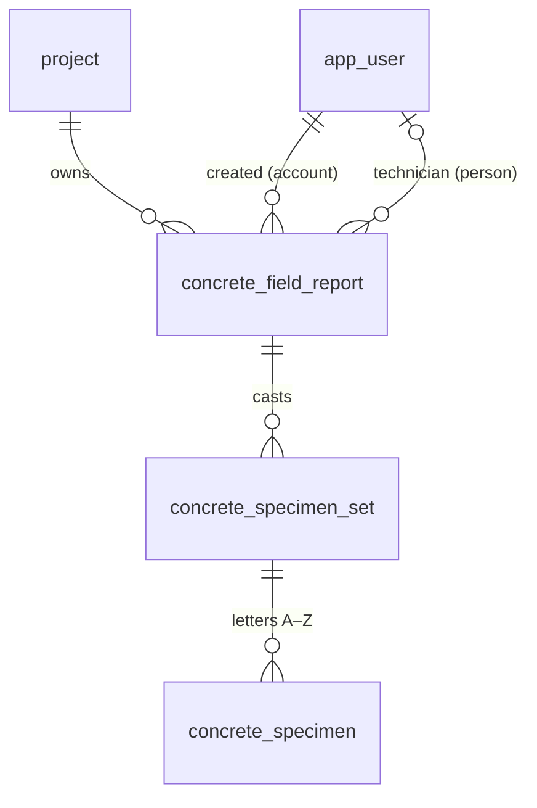

# Concrete domain (V2)

Concrete field reports, specimen sets and specimens: a domain separate from geotechnical storage
units. Requirements: Notion "V2 Concrete — Specification" (decisions CD-xx) and the Concrete
Development Board (cards MM-V2-Cxx). Permissions: [permissions.md](permissions.md#concrete-permission-contract-mm-ao08).

**Status (MM-V2-C01):** the aggregate roots exist in the database (migration
`0015_concrete_domain.sql`) and as shared contracts (`packages/shared/src/concrete.ts`, fixtures in
`concrete-fixtures.ts`). Nothing else is implemented: no route, screen, offline store, allocator,
submission, review, issuance or calculation reads or writes these tables yet.

## A deliberate new domain

Concrete specimens are individual records, and later cards receive them one by one (C06: one mass
per specimen). That is intentional and applies to concrete only. Geotechnical receiving is
unchanged: per storage unit, with one SAMPLE#/DEPTH summary per test hole and no individual sample
inventory (CLAUDE.md "Never"). Concrete identity never uses storage-unit IDs
(`BKT-`/`ST-`/`CRE-`/`CT-`), their annual counters, receipts or label printing, and migration 0015
changes none of those tables (proven in `schema-concrete.test.ts`, AC1).

## Records

| Table                               | What it is                                                                     |
| ----------------------------------- | ------------------------------------------------------------------------------ |
| `concrete_field_report`             | One sampled load / test (CD-13). Zero sets is valid.                           |
| `concrete_specimen_set`             | Specimens cast from that load. The schema sets no cap on sets per report.      |
| `concrete_specimen`                 | One specimen, lettered A–Z in its set: at most 26 (CD-10), no fixed row count. |
| `concrete_specimen_identity` (view) | A specimen's temporary and permanent ID: its set's plus its letter.            |

Every table has `id` (UUID), `project_id`, `version` (optimistic concurrency, starts at 1),
`created_at` and `updated_at`. The API sets `version`/`updated_at`, as for other tables.

### Rules the database enforces (each proven in `apps/api/src/db/schema-concrete.test.ts`)

- **Same project down the tree.** A set references `(project_id, field_report_id)` and a specimen
  `(project_id, set_id)`, so a child can never sit under a parent in another project (AC2). A
  report's project correction cascades to its sets and specimens; a set or specimen can't change
  project on its own.
- **Internal UUIDs never change** (trigger), so a client may generate them offline and a retried
  sync of the same record is the same row.
- **Aliases (spec page 3).** A set's `temporary_id` (`TMP-<device>-<counter>`, CD-06; unique
  everywhere, since device codes are never reused) and `permanent_id` + `permanent_number`
  (`YY-NN` / `GYY-NN`, CD-07/CD-11) are nullable and attached later; once attached they never
  change or clear (AC4). A draft holds neither and consumes nothing (AC3).
- **One counter per project for all materials.** `permanent_number` is unique per project
  whatever the year or `G` prefix; set numbers may repeat across projects. The ID's number part
  must equal `permanent_number` with at least two digits (`27-03`, not `27-3` or `27-003`).
- **Numbers stay in the register (CD-08).** A numbered set can't be deleted, can't change project,
  and its specimens can't be deleted or re-lettered. Unnumbered draft sets and specimens may be.
  Sets and specimens can't be truncated.
- **Attribution vs authority.** `created_by_user_id` is the signed-in account (may be LAB);
  `technician_user_id` is the person credited, checked to be an active personal or test account
  when set (a later disable keeps the credit). Optional while a draft.

## Four status dimensions

Never folded into one value (spec page 1). Contracts in `packages/shared/src/concrete.ts`:

| Dimension          | Where                                                                                                        | Values                                                                                                                                                                        |
| ------------------ | ------------------------------------------------------------------------------------------------------------ | ----------------------------------------------------------------------------------------------------------------------------------------------------------------------------- |
| Draft completeness | computed each time, never stored (`concreteDraftCompletenessSchema`)                                         | `complete` + `missingRequired` field paths. Missing draft data is `null`, never 0 or No.                                                                                      |
| Workflow state     | `workflow_state`, `ready_to_submit_at`, `submitted_at` (`concreteWorkflowSchema`)                            | `draft`, `ready_to_submit`, `submitted`, `returned`, `reviewed`, `void`. Ready to submit needs its intent time; `submitted_at` is set exactly when submitted.                 |
| Sync               | device only (`concreteDeviceSyncStatusSchema`); server acknowledgment (`concreteReportAcknowledgmentSchema`) | `saved_on_device`, `pending_upload`, `accepted`, `needs_attention`, `conflict`; the acknowledgment names the accepted version. Attachments are acknowledged separately (C15). |
| Issuance           | `issue_count`, `last_issued_*` (`concreteIssuanceSchema`)                                                    | `not_issued` / `issued`, the count and the latest issue (version, time, issuer), all or none.                                                                                 |

Specimen lifecycle (Expected … Disposed) and strength-report status are further dimensions owned by
later cards (below); they are not modelled yet.

## Field ownership

C01 owns only the columns above. Each later card adds its fields in its own migration and extends
the shared contracts; none may repurpose a C01 column.

| Card | Owns                                                                                                                                                           |
| ---- | -------------------------------------------------------------------------------------------------------------------------------------------------------------- |
| C02  | Project concrete settings, the concrete Lab Manager grant, reusable concrete policy                                                                            |
| C03  | Mixes, approval and specification history                                                                                                                      |
| C04  | Field-report detail (project/load, location and times, field tests, material, notes, snapshots) and draft APIs; the completeness field list                    |
| C05  | Set and specimen detail (mould, per-specimen age / HOLD assignment) and further identity records                                                               |
| C06  | **Pickup, initial curing and receiving detail** (pickup time and collector, curing min/max, receiving time and person, mass per specimen, marker confirmation) |
| C07  | **Numerical test results**, tester attribution and correction history                                                                                          |
| C09  | Report versions and issuance lifecycle (writes the issuance columns; decides what "Revised" shows)                                                             |
| C12  | Device registration and the temporary-ID counter (device codes)                                                                                                |
| C15  | Attachments and their acknowledgment                                                                                                                           |
| C17  | Sync protocol, acknowledgment and conflicts; project placeholder matching (CD-24)                                                                              |
| C18  | Permanent set-number allocator (project counter row, locked in the accepting transaction; never a sequence) and Void                                           |
| C19  | Ready to submit and server submission (writes the workflow columns)                                                                                            |
| C24+ | Strength calculation, failed-test workflow, HOLD and disposal                                                                                                  |

## Project settings and authority (C02)

- **Settings** (`GET`/`PATCH /api/projects/:projectId/concrete-settings`, contracts in
  `packages/shared/src/concrete-settings.ts`): default specimen ages (7 / 28 / 28 / HOLD), HOLD
  duration (56 days from casting) and whether issued reports include the testing machine's
  make/model and calibration dates (unset until chosen). They are defaults for sets created later:
  the set/specimen card (C05) copies them onto a new set when it assigns ages, and nothing rewrites
  an existing set, schedule or issued report when they change. The 56 days is a duration; later
  cards compute the date from casting. Kyle will review the full settings list later; this list is
  not exhaustive.
- **Reviewers** are not a setting: they are MISC-08 reviewer assignments for `concrete_field` /
  `concrete_strength`, effective only with eligibility, accepted team membership and the lead's
  approval. A route checking `concrete.review` loads them with
  `projectContext(db, project, undefined, scope)` (fills `designatedReviewerUserIds`).
- **Concrete Lab Manager grant** (D13): `GET/POST /api/projects/:projectId/concrete-lab-managers`,
  `DELETE …/:id {reason}`, under `project.edit` (lead or admin). `projectContext(db, project, reportScope, reviewScope, { concreteLabManagers: true })` fills `concreteLabManagerUserIds`; the policy
  counts it only with the lab_manager role (`concrete_hold.manage`).
- **For each concrete route:** load the project facts with `projectContext()`, check `can()` with
  the request's user before the body, then again under the D09 lock order (domain rows, project,
  accounts: `canUnderLock`), and add the action to `PROJECT_CAPABILITY_ACTIONS` in the same change.

## Notes for later cards

- **Project placeholders (CD-24):** `project_id` is required. If C17 needs to accept a report before
  its project is matched, it adds that in its own migration; numbering and submission still wait.
- **G prefix and casting year:** the database checks the permanent ID's shape and number, not that
  `G` matches a grout material or `YY` the casting year; C04 adds material and casting date, and
  C18 allocates from them.
- **Sets per report:** the field form shows one specimen set per report (spec page 2); the schema
  doesn't cap it, and sets without a field report (workbook import, C34) would need a later change.
- **Audit:** C02 added `concrete_project_settings.updated` and
  `project_concrete_lab_manager_grant.granted`/`.revoked`; each writing card records its own with
  `recordAudit` in the same transaction.
- **Open owner inputs, deliberately not defaulted:** testing-machine / worksheet units and reading
  count, calculation and rounding methods, final and summary report templates, CSA/ASTM curing and
  pickup limits, paper Field ID vs Set ID (CD-65), externally numbered sets (CD-69), a report-level
  reference number (none is defined).
