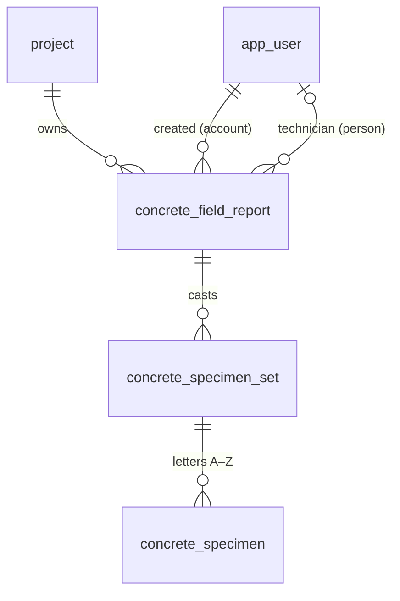
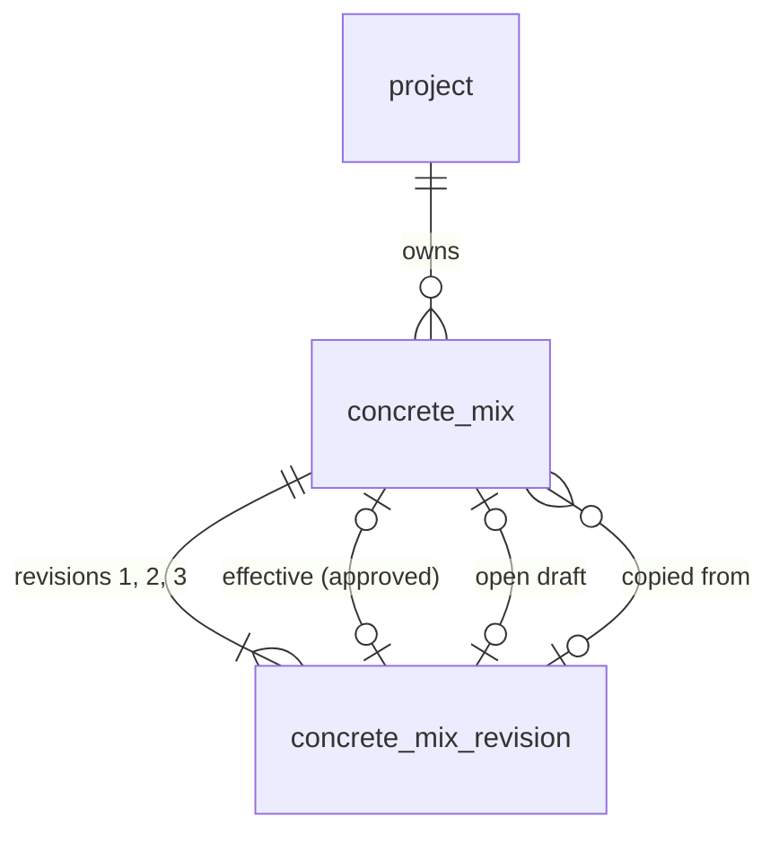

# Concrete domain (V2)

Concrete field reports, specimen sets and specimens: a domain separate from geotechnical storage
units. Requirements: Notion "V2 Concrete — Specification" (decisions CD-xx) and the Concrete
Development Board (cards MM-V2-Cxx). Permissions: [permissions.md](permissions.md#concrete-permission-contract-mm-ao08).

**Status:** the aggregate roots exist in the database (MM-V2-C01, migration
`0015_concrete_domain.sql`) and as shared contracts (`packages/shared/src/concrete.ts`, fixtures in
`concrete-fixtures.ts`); project settings and the concrete Lab Manager grant (C02, `0016`); project
mixes with approval and specification history (C03, `0017`, below). No route, screen, offline
store, allocator, submission, review, issuance or calculation reads or writes the report, set or
specimen tables yet.

## A deliberate new domain

Concrete specimens are individual records, and later cards receive them one by one (C06: one mass
per specimen). That is intentional and applies to concrete only. Geotechnical receiving is
unchanged: per storage unit, with one SAMPLE#/DEPTH summary per test hole and no individual sample
inventory (CLAUDE.md "Never"). Concrete identity never uses storage-unit IDs
(`BKT-`/`ST-`/`CRE-`/`CT-`), their annual counters, receipts or label printing, and migration 0015
changes none of those tables (proven in `schema-concrete.test.ts`, AC1).

## Records

| Table                               | What it is                                                                     |
| ----------------------------------- | ------------------------------------------------------------------------------ |
| `concrete_field_report`             | One sampled load / test (CD-13). Zero sets is valid.                           |
| `concrete_specimen_set`             | Specimens cast from that load. The schema sets no cap on sets per report.      |
| `concrete_specimen`                 | One specimen, lettered A–Z in its set: at most 26 (CD-10), no fixed row count. |
| `concrete_specimen_identity` (view) | A specimen's temporary and permanent ID: its set's plus its letter.            |

Every table has `id` (UUID), `project_id`, `version` (optimistic concurrency, starts at 1),
`created_at` and `updated_at`. The API sets `version`/`updated_at`, as for other tables.

### Rules the database enforces (each proven in `apps/api/src/db/schema-concrete.test.ts`)

- **Same project down the tree.** A set references `(project_id, field_report_id)` and a specimen
  `(project_id, set_id)`, so a child can never sit under a parent in another project (AC2). A
  report's project correction cascades to its sets and specimens; a set or specimen can't change
  project on its own.
- **Internal UUIDs never change** (trigger), so a client may generate them offline and a retried
  sync of the same record is the same row.
- **Aliases (spec page 3).** A set's `temporary_id` (`TMP-<device>-<counter>`, CD-06; unique
  everywhere, since device codes are never reused) and `permanent_id` + `permanent_number`
  (`YY-NN` / `GYY-NN`, CD-07/CD-11) are nullable and attached later; once attached they never
  change or clear (AC4). A draft holds neither and consumes nothing (AC3).
- **One counter per project for all materials.** `permanent_number` is unique per project
  whatever the year or `G` prefix; set numbers may repeat across projects. The ID's number part
  must equal `permanent_number` with at least two digits (`27-03`, not `27-3` or `27-003`).
- **Numbers stay in the register (CD-08).** A numbered set can't be deleted, can't change project,
  and its specimens can't be deleted or re-lettered. Unnumbered draft sets and specimens may be.
  Sets and specimens can't be truncated.
- **Attribution vs authority.** `created_by_user_id` is the signed-in account (may be LAB);
  `technician_user_id` is the person credited, checked to be an active personal or test account
  when set (a later disable keeps the credit). Optional while a draft.

## Four status dimensions

Never folded into one value (spec page 1). Contracts in `packages/shared/src/concrete.ts`:

| Dimension          | Where                                                                                                        | Values                                                                                                                                                                        |
| ------------------ | ------------------------------------------------------------------------------------------------------------ | ----------------------------------------------------------------------------------------------------------------------------------------------------------------------------- |
| Draft completeness | computed each time, never stored (`concreteDraftCompletenessSchema`)                                         | `complete` + `missingRequired` field paths. Missing draft data is `null`, never 0 or No.                                                                                      |
| Workflow state     | `workflow_state`, `ready_to_submit_at`, `submitted_at` (`concreteWorkflowSchema`)                            | `draft`, `ready_to_submit`, `submitted`, `returned`, `reviewed`, `void`. Ready to submit needs its intent time; `submitted_at` is set exactly when submitted.                 |
| Sync               | device only (`concreteDeviceSyncStatusSchema`); server acknowledgment (`concreteReportAcknowledgmentSchema`) | `saved_on_device`, `pending_upload`, `accepted`, `needs_attention`, `conflict`; the acknowledgment names the accepted version. Attachments are acknowledged separately (C15). |
| Issuance           | `issue_count`, `last_issued_*` (`concreteIssuanceSchema`)                                                    | `not_issued` / `issued`, the count and the latest issue (version, time, issuer), all or none.                                                                                 |

Specimen lifecycle (Expected … Disposed) and strength-report status are further dimensions owned by
later cards (below); they are not modelled yet.

## Field ownership

C01 owns only the columns above. Each later card adds its fields in its own migration and extends
the shared contracts; none may repurpose a C01 column.

| Card | Owns                                                                                                                                                           |
| ---- | -------------------------------------------------------------------------------------------------------------------------------------------------------------- |
| C02  | Project concrete settings, the concrete Lab Manager grant, reusable concrete policy                                                                            |
| C03  | Mixes, approval and specification history                                                                                                                      |
| C04  | Field-report detail (project/load, location and times, field tests, material, notes, snapshots) and draft APIs; the completeness field list                    |
| C05  | Set and specimen detail (mould, per-specimen age / HOLD assignment) and further identity records                                                               |
| C06  | **Pickup, initial curing and receiving detail** (pickup time and collector, curing min/max, receiving time and person, mass per specimen, marker confirmation) |
| C07  | **Numerical test results**, tester attribution and correction history                                                                                          |
| C09  | Report versions and issuance lifecycle (writes the issuance columns; decides what "Revised" shows)                                                             |
| C12  | Device registration and the temporary-ID counter (device codes)                                                                                                |
| C15  | Attachments and their acknowledgment                                                                                                                           |
| C17  | Sync protocol, acknowledgment and conflicts; project placeholder matching (CD-24)                                                                              |
| C18  | Permanent set-number allocator (project counter row, locked in the accepting transaction; never a sequence) and Void                                           |
| C19  | Ready to submit and server submission (writes the workflow columns)                                                                                            |
| C24+ | Strength calculation, failed-test workflow, HOLD and disposal                                                                                                  |
| C27  | Equipment register: the testing machine and air meters, calibration history and the equipment flag rule                                                        |

## Project settings and authority (C02)

- **Settings** (`GET`/`PATCH /api/projects/:projectId/concrete-settings`, contracts in
  `packages/shared/src/concrete-settings.ts`): default specimen ages (7 / 28 / 28 / HOLD), HOLD
  duration (56 days from casting) and whether issued reports include the testing machine's
  make/model and calibration dates (unset until chosen). They are defaults for sets created later:
  the set/specimen card (C05) copies them onto a new set when it assigns ages, and nothing rewrites
  an existing set, schedule or issued report when they change. The 56 days is a duration; later
  cards compute the date from casting. Kyle will review the full settings list later; this list is
  not exhaustive.
- **Reviewers** are not a setting: they are MISC-08 reviewer assignments for `concrete_field` /
  `concrete_strength`, effective only with eligibility, accepted team membership and the lead's
  approval. A route checking `concrete.review` loads them with
  `projectContext(db, project, undefined, scope)` (fills `designatedReviewerUserIds`).
- **Concrete Lab Manager grant** (D13): `GET/POST /api/projects/:projectId/concrete-lab-managers`,
  `DELETE …/:id {reason}`, under `project.edit` (lead or admin). `projectContext(db, project, reportScope, reviewScope, { concreteLabManagers: true })` fills `concreteLabManagerUserIds`; the policy
  counts it only with the lab_manager role (`concrete_hold.manage`).
- **For each concrete route:** load the project facts with `projectContext()`, check `can()` with
  the request's user before the body, then again under the D09 lock order (domain rows, project,
  accounts: `canUnderLock`), and add the action to `PROJECT_CAPABILITY_ACTIONS` in the same change.

## Project mixes (C03)

Decisions: CD-52 (project-specific; the project's Lead Project Engineer alone creates, edits,
copies and approves; copies start Unapproved; new mixes default to 7 / 28 / 28 / HOLD), D14
(editing an approved mix makes a draft revision; the approved one stays in effect until the lead
approves), CD-17 (slump target ± tolerance, air min–max), CD-15 (an unknown or unapproved mix on a
report is flagged, never a registry edit). Routes and checks:
[permissions.md](permissions.md#concrete-permission-contract-mm-ao08). Contracts:
`packages/shared/src/concrete-mixes.ts`.

- **`concrete_mix`** is the stable identity (its id never changes; supplier and mix number as its
  latest revision states them, unique per project ignoring case). Status is derived, never stored:
  `unapproved` (no approved revision), `approved`, `revision_pending` (approved plus a draft).
- **`concrete_mix_revision`** holds the specification: supplier, mix number (text, leading zeros
  kept), plants (0–20; the field form autofills when there is one), strength MPa, optional
  specified strength age (separate from the test ages), slump target and tolerance mm, air min/max
  %, max aggregate size mm, cement type, project-spec admixtures, supplier-ticket defaults (a
  separate column: defaults only, never evidence a ticket was checked) and test ages (days or
  HOLD, repeats distinct). A draft may leave values null (never 0); approval needs strength, slump,
  air, aggregate and cement (`CONCRETE_MIX_APPROVAL_REQUIRED_FIELDS`, also checked by the database).
- **Admixtures**: `declaration` null (not answered), `none`, `unknown` or `listed` with items
  (superplasticizer L/m³, fibres kg/m³, accelerator, ice, winter heat, air, retarder, corrosion
  inhibitor, pigment, other with a description). Dosage-required rules are open, so none are
  enforced.
- **Test ages for a new mix** come from the project's concrete settings (C02 default
  7 / 28 / 28 / HOLD); ages given on create win. Later setting changes never touch existing mixes.
- **History**: every revision is kept (approved and superseded ones never change, enforced by a
  trigger) and every change is audited on the mix (`concrete_mix.created`, `.copied`,
  `.draft_edited`, `.revision_drafted`, `.approved`) with only the changed fields, the revision
  number, who, when and an optional note. Retries are exactly-once through `concrete_mix_command`.
- **Copy** makes a new Unapproved mix in the destination from the source's approved revision (or a
  named one; else its draft), recording `copied_from_revision_id`; the source and its approval
  never change.
- **Not in C03:** no Mixes tab or other UI, no draft discard or retirement, no file attachments,
  no propagation. Propagation is a contract only (`concreteMixPropagationRequestSchema`,
  `concreteMixPropagationPreviewSchema`, `concreteMixPropagationDecisionSchema`: per item or
  Approve all of the displayed list; measured data, tested specimens and issued reports never
  change).

### For C04 / C05

- Store a field report's or set's mix as a `concreteMixSnapshotSchema` value: the revision id (an
  approved revision never changes, so the id stays faithful) plus the copied values. Never read the
  live mix to display what a saved report used (AC5).
- A report may name a mix that isn't in the registry or isn't approved (CD-15): keep the manual
  entries, flag it, and never create or edit a registry mix from field data (AC4).
- Sets copy `testAges` from the snapshot (mix, else project, else lab default) when created; later
  mix edits never re-schedule existing specimens.

## Equipment (C27)

Migration `0018_concrete_equipment.sql`; contracts and the flag rule in
`packages/shared/src/concrete-equipment.ts`; routes and permissions in
[permissions.md](permissions.md#concrete-equipment-mm-v2-c27). Screen: Settings → Equipment.

- **Register** (`concrete_equipment`): kind `testing_machine` or `air_meter`, equipment ID (required
  for air meters, unique ignoring case among equipment not retired), description, make, model,
  status (`in_service`, `out_of_service` = an unresolved equipment issue, `retired` = final, each
  with a note saying why) and, for air meters only, the assigned technician (active personal staff
  when assigned). One testing machine at a time (CD-44, no per-test selector): a replaced machine
  is retired, keeping its history, before the next is registered. Never deleted.
- **Calibration history** (`concrete_equipment_calibration`, AC2): entries numbered 1, 2, 3… per
  equipment with calibration date, next-due date, who performed it and the result (free text).
  Never overwritten or deleted; a mistaken entry is voided with a reason and stays listed. The
  machine's "last calibration / next due" is the entry in effect: the latest one not voided whose
  calibration date is on or before the date in question.
- **Flag rule** (`concreteEquipmentFlags`, CD-45): using equipment on a date flags
  `calibration_overdue` when that date is after the next-due date of the entry in effect,
  `calibration_due_on_use_date` on the due date itself (the boundary procedure is an open owner
  input; both only warn), `no_calibration_recorded` when no entry applies, and
  `equipment_out_of_service` / `equipment_retired` from the status. **Only the recorded next-due
  date counts: no calibration interval exists anywhere.** Flags never block saving.
- **For the cards that use equipment.** The result-level flag records belong to the records that
  use equipment; C27 gives them the evaluation:
  - C04/C14 (field report air meter, optional): `GET /api/concrete/air-meters/assigned` autofills
    the performing technician's meter when exactly one is assigned (none or several: left blank,
    editable). Store the chosen equipment id and the `use` evaluation (calibration id, next due,
    flags) with the field test, and recheck on sync.
  - C23 (testing table): `testingMachineSnapshot(db, testDate)` /
    `evaluateEquipmentUse(db, id, testDate)` in `concrete-equipment.service.ts`; store the
    evaluation with each result.
  - C28 (review checklist) and the Exceptions worklist (C31): read those stored flags; an equipment
    flag needs review before issuance (CD-45). C29 sends the equipment-flag notification.
  - C32 (issued reports): copy `testingMachineSnapshot()` into the issued version when the project
    setting includes machine info; later register changes never alter an issued file.
- **Gated (owner inputs, not built):** the air-meter calibration form (procedure readings; out of
  scope until mapped), calibration attachments (C15), the due-date boundary procedure, who
  manages air meters (proposal: Lab Manager), scale integration and machine data import (out of
  scope).

## Notes for later cards

- **Project placeholders (CD-24):** `project_id` is required. If C17 needs to accept a report before
  its project is matched, it adds that in its own migration; numbering and submission still wait.
- **G prefix and casting year:** the database checks the permanent ID's shape and number, not that
  `G` matches a grout material or `YY` the casting year; C04 adds material and casting date, and
  C18 allocates from them.
- **Sets per report:** the field form shows one specimen set per report (spec page 2); the schema
  doesn't cap it, and sets without a field report (workbook import, C34) would need a later change.
- **Audit:** C02 added `concrete_project_settings.updated` and
  `project_concrete_lab_manager_grant.granted`/`.revoked`, C03 the `concrete_mix.*` events; each writing card records its own with
  `recordAudit` in the same transaction.
- **Open owner inputs, deliberately not defaulted:** testing-machine / worksheet units and reading
  count, calculation and rounding methods, final and summary report templates, CSA/ASTM curing and
  pickup limits, paper Field ID vs Set ID (CD-65), externally numbered sets (CD-69), a report-level
  reference number (none is defined).
