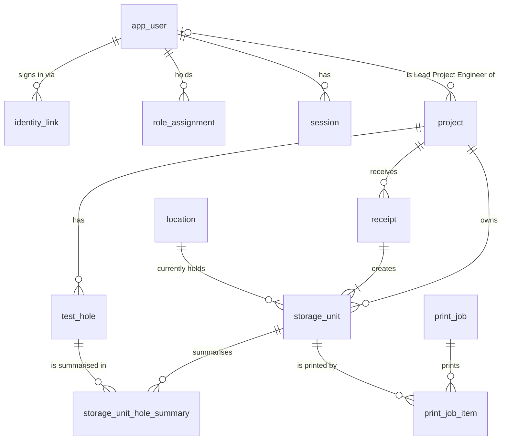

# Database

PostgreSQL 17, one database per environment (`materialmule_dev`, `materialmule_test`, production).
Schema changes live in `apps/api/migrations/NNNN_snake_name.sql` and are applied by the small
runner in `apps/api/src/db/migrator.ts` (MM-T02).

## Commands

| Command                                             | What it does                                                                                                      |
| --------------------------------------------------- | ----------------------------------------------------------------------------------------------------------------- |
| `npm run db:migrate`                                | Apply pending migrations, then load reference data (Receiving lab)                                                |
| `npm run db:seed:dev`                               | Load fictional fixtures (DEMO-2601, TH26-01/02, 7 test identities, 2 pending applicants). Refused in prod         |
| `npm run db:reset:dev`                              | Re-apply the dev fixtures without changing IDs or audit (same as `db:seed:dev`)                                   |
| `npm run db:seed:demo`                              | Load demo data through the running dev API (needs `ENABLE_TEST_AUTH=true`); see README "Demo data"                |
| `npm run db:rebuild:dev -- --disposable <database>` | Drop and rebuild a disposable development database: baseline, reference data, fixtures (APP_ENV=development only) |
| `npm run db:reset:test`                             | Drop and rebuild the test database from `.env.test` (APP_ENV=test only)                                           |

In production, run the compiled CLI instead: `node apps/api/dist/db/cli.js migrate`.

## Seed data

Four sets, each with its own job. All data except the reference data is fictional (DEMO- project
numbers, invented people and clients) and none of it can be loaded in production.

| Set            | Source                           | Loaded by                                | Where                    | What it is for                                                                                                                                                      |
| -------------- | -------------------------------- | ---------------------------------------- | ------------------------ | ------------------------------------------------------------------------------------------------------------------------------------------------------------------- |
| Reference data | `apps/api/seed/reference.sql`    | `db:migrate`, `db:seed`                  | every environment        | What production needs to start: the Receiving lab, the shared LAB account, the Soils / Advanced Soils groups and the starter template. Idempotent.                  |
| Dev fixtures   | `apps/api/seed/dev.sql`          | `db:seed:dev`, `db:reset:dev`, E2E setup | development, test, bench | The minimum tests rely on: 7 test sign-in identities, 2 pending applicants, DEMO-2601/2602, a few 2024 units at WH-C2, 3 DEMO test types. Fixed UUIDs; re-runnable. |
| Demo data      | `apps/api/src/demo/seed-cli.ts`  | `db:seed:demo` (against a running API)   | development              | Hands-on testing: DEMO-2610–2615 with receipts, moves, lab programs in every stage, retention and disposal. Created through the real API, so it is fully audited.   |
| Benchmark data | `apps/api/src/bench/generate.ts` | `bench:seed`                             | a bench or test database | Ten-year and 5x stress volumes for MM-T19 ([performance/README.md](performance/README.md)). Deterministic; never loaded into dev.                                   |

Which one to change:

- **Something production needs on day one** goes in `reference.sql`, written so it can run again
  without changing anything.
- **Something an automated test depends on** goes in `dev.sql`. Keep it small: E2E reloads it
  before every run (`playwright.config.ts`), test sign-in reads its user IDs
  (`apps/api/src/auth/test-provider/fixtures.ts`), and E2E and API tests use its fixed units
  (e.g. `BKT-2024-000001`, DEMO-2602, WH-C2). Don't remove or renumber those to tidy up.
- **Something that only makes manual testing richer** goes in the demo seeder. It never runs in
  automated tests, so nothing may depend on it.

### Loading demo data

```powershell
npm run dev                      # API on 3000 with ENABLE_TEST_AUTH=true; leave it running
npm run db:seed:demo             # in a second terminal
npm run db:seed:demo -- --url http://127.0.0.1:3100   # an API on another port
```

It needs the dev fixtures (it signs in as them) and test sign-in, which never exists in
production. Received dates count back from today, so retention and "recently received" always
have something to show. A run that stops partway picks up where it left off when run again;
once the dataset is complete it refuses to load twice. To start over:
`npm run db:rebuild:dev -- --disposable materialmule_dev`, then `npm run db:seed:demo`.

## Migration rules

- Forward-only. Never edit a migration after it has been applied anywhere: the runner stores a
  SHA-256 of each file and refuses to run if an applied file changed. Write a new migration
  with the next free number.
- Each migration runs in one transaction; a failure leaves no partial schema.
- A PostgreSQL advisory lock stops two migrators racing on the same database.
- Put integrity rules in the database (foreign keys, `CHECK`, unique indexes), then prove each one
  with a test in `apps/api/src/db/schema*.test.ts`.
- Enumerations are `text` + `CHECK`, not PostgreSQL enum types, so they can be extended in a
  later migration without `ALTER TYPE`.

## Clean baseline (MM-AO02, owner decision 2026-10-29)

The application was never deployed, so the pre-release lineage `0001_initial_schema` …
`0078_same_source_tested_units` was replaced by one reviewed file, `0001_baseline.sql`, under Lead
Project Engineer naming. This was a one-time, owner-approved exception to the forward-only rule;
it is not permission to reset a deployed database, and forward-only migrations resume from here.

- **What the baseline is.** The same tables, columns (in the same order), constraints, indexes,
  functions, triggers, views and grants the lineage ended with, with every later column folded into
  its table and each function and trigger in its final form. Upgrade-only backfills are gone (a
  baseline starts empty). The only intended differences from the lineage's end state, besides
  the renames: `audit_event_receiver_snapshot_required` is a validated check (it was `NOT VALID`
  to spare pre-MM-T56 rows), and the MM-AO02 storage below. A catalog comparison of the two
  (tables, columns, constraint and index definitions, function bodies, triggers, views, grants,
  seeded rows) showed no other difference when the baseline was cut.
- **Renamed.** `project.pm_pe_user_id` → `lead_project_engineer_user_id`, `project_pm_pe_idx` →
  `project_lead_project_engineer_idx`, `action_item_routes_to_pm_pe()` →
  `action_item_routes_to_lead_project_engineer()`, and the staff position `pm_pe` →
  `project_engineer` (job metadata, label "Project Engineer"). The Lab Manager role is unchanged.
- **Databases from the retired lineage.** The migrator refuses any database whose
  `schema_migration` recorded `0001_initial_schema`, with a message naming the rebuild commands;
  it never upgrades one. Rebuild only an explicitly designated disposable database:
  `npm run db:rebuild:dev -- --disposable materialmule_dev` (development: it checks `APP_ENV` and
  that the name matches the connected database) or `npm run db:reset:test` (test). Export
  anything worth keeping first; nothing is carried over. Dev fixtures use fixed UUIDs, so a
  rebuilt development database has the same people and projects.
- **Browser drafts.** Receiving drafts moved to record version 3: a version-2 draft forgets its
  chosen project (and so its hole choices, as choosing another project does) because the project
  summary now names its lead under `leadProjectEngineer`; everything else is kept.

## Roles

- **Development and test:** one login (`materialmule`) owns both databases and runs migrations.
- **Production (MM-T20):** a migration role (`materialmule_owner`) owns the schema and every table
  and is used only by the deploy script; the API connects as `materialmule_app`, which can read and
  write rows but not create, alter or drop anything, only read `schema_migration`, and only read and
  insert into `audit_event`. Neither role is a superuser. `node apps/api/dist/db/cli.js setup-roles
<migration-role> <app-role> [<backup-role>]` (as `postgres`, via `DATABASE_ADMIN_URL`) creates and
  grants them (the optional backup role gets read-only access for `pg_dump` and the monitor task);
  it is idempotent. Proven in `apps/api/src/db/roles.test.ts` (runs where the test database user
  is a superuser, as in CI). Steps: [operations runbook](operations/runbook.md).

## Tests

Database tests read `TEST_DATABASE_URL` (falling back to `DATABASE_URL` in `apps/api/.env.test`).
Each test file creates its own temporary schema (`test_<random>`), migrates it and drops it
afterwards, so files run in parallel without sharing data.

## Schema (MM-T02)



Key rules enforced by the database:

- **One project per storage unit (D12).** `storage_unit_hole_summary` references both
  `storage_unit (project_id, id)` and `test_hole (project_id, id)` with the same `project_id`, so a
  summary can't join a unit to another project's test hole.
- **One summary per test hole per unit**, each shaped by type: ALL (no fields), sample range
  (from + to), depth range (from ≤ to, both ≥ 0, unit `ft` or `m`, stored as `numeric(8,2)`),
  Custom (non-blank text).
- **Storage unit IDs** match `^(CT|BKT|ST|CRE)-YYYY-NNNNNN$`. The prefix must match the physical
  holder at issue (`BKT` bucket, `ST` Shelby tube, `CRE` core box, `CT` generic), and the year
  must match `issued_year`. A trigger makes `readable_id`, `id_prefix`, `issued_year` and
  `issued_holder_kind` immutable; current `unit_type` / `holder_kind` stay correctable (D45).
- **Counters:** `storage_unit_annual_counter` has one row per prefix and year, capped at 999,999.
  `allocateStorageUnitIds` (`apps/api/src/numbering`) increments it inside the caller's
  transaction, so concurrent receipts serialise on the row and a rollback returns the numbers.
  The year is the confirmation date in `BUSINESS_TIME_ZONE` (America/Edmonton), never the
  received date. Note: tzdata 2026c has Edmonton on UTC−6 all year.
- **Issued IDs are never reused (MM-T47).** Triggers, which also bind the table
  owner, refuse `DELETE` and `TRUNCATE` on `storage_unit` (units leave through `status`, never by
  deletion) and on `storage_unit_annual_counter`, and any `UPDATE` that lowers a counter's
  `last_value` or moves it to another prefix or year. Raising a counter is allowed (e.g. after a
  restore). Errors use SQLSTATE `23001` (`restrict_violation`) and name the unit or counter. A
  receipt that issued units can't be deleted either (foreign key from `storage_unit`). Hole
  summaries carry no ID, so corrections may still replace them. Test and dev resets drop and
  recreate the schema (`db:reset:test`, `createMigratedSchema`), never delete rows; a test that
  needs fresh counters uses its own scratch schema.
- **Audit events are append-only**: triggers reject `UPDATE`, `DELETE` and
  `TRUNCATE` even for the table owner. Record events with `recordAudit` (`apps/api/src/audit`)
  on the same transaction client as the change; actor initials and name are snapshots.
- **Audit receivers are snapshots too (MM-T56).** An event that credits a
  receiver (receipts, LAB-station prints, project and test-hole creation) stores
  `receiver_initials_snapshot` and `receiver_name_snapshot` next to `receiver_user_id`. A check
  (`audit_event_receiver_snapshot_required`, fully validated since the MM-AO02 baseline) refuses
  any event with a receiver but no name snapshot, or snapshots without a receiver; initials may be
  NULL for staff without confirmed initials. Storage unit history reads the event snapshot; its
  receipt-snapshot and live-user fallbacks are defensive only.
- **Print job people are snapshots (MM-T65).** A job stores the requester
  (`requested_by_*_snapshot`) and any receiver it credits (`receiver_*_snapshot`, a print at a LAB
  station) as of the request, and whoever confirmed the labels came out (`confirmed_by_*_snapshot`)
  as of the confirmation (Kyle, 2026-10-27). A trigger refuses a new job, a new or changed
  receiver, or a new confirmation without the person's name snapshot, and refuses clearing one; a
  CHECK refuses snapshots without the person.
- **Project numbers and test-hole names** are stored trimmed and unique ignoring case (test holes
  per project only). Creates rely on those unique indexes (`INSERT … ON CONFLICT DO NOTHING`),
  so of two parallel creates exactly one succeeds and the other gets 409 with the existing row
  (MM-T08). `text_pattern_ops` indexes serve prefix search.
- **Receipts** hold 1–50 storage units (owner decision 2026-10-25). Each unit records its
  `receipt_line` (1 = first submitted, unique per receipt) so a retried
  confirmation returns the same row-to-ID mapping.
- **Receiving lab** is a system location and can't be deactivated.
- No individual sample table: receiving is per storage unit.
- **LAB credentials (MM-T06).** `local_credential` holds one Argon2id PHC string
  per account (the string records its own cost); a trigger allows it only for `shared_lab`
  accounts. `sign_in_throttle` counts failed local sign-ins per account and per client address.
  Reference data seeds the LAB account (`app_user` 00000000-0000-4000-8000-000000000001 with a
  `local_lab` identity, subject `LAB`) without a password: an admin sets it in
  Settings → Staff & access. LAB sign-in and the LAB password reset each start by taking
  `FOR NO KEY UPDATE` on LAB's `app_user` row, then read the hash in a new statement, then lock
  `sign_in_throttle` rows (MM-T40). That lock order serialises "verify password, create session"
  with "replace password, revoke sessions", so no old-password session outlives a reset.
- **Staff (MM-T07).** Official initials are not unique. `expected_upn` (an
  admin's pre-provisioned work email) is unique ignoring case when set; `approved_by` and
  `approved_at` are set together; `disabled_reason` exists only on a disabled account. Receipts
  keep receiver ID + initials + name snapshots, so renaming or disabling someone never rewrites
  history.

## Print queue (MM-T15)

- **Printers** (`printer`) are server-side configuration: key, name, host (IPv4 or host name),
  port (9100), enabled, default (at most one), status check. Print requests may only name a
  configured, enabled printer key; a host or port in a request is rejected. `LABEL_PRINTER_HOST`
  creates the `receiving` printer the first time the API starts with it set; afterwards an admin
  changes printers at `PUT /api/admin/printers` (Settings → Printers). Printers are never
  deleted (jobs reference them); turn one off instead.
- **Jobs** (`print_job` + `print_job_item` in print order) record kind (initial / reprint),
  template version, requesting account and, for the shared LAB account, the staff receiver.
- **Status rules** (worker in `apps/api/src/printing`, running inside the API process, one job
  at a time per printer, oldest first):
  - nothing sent (refused, timed out, host status reports paper out / head open / paused) →
    back to `queued` with backoff (5 s, 10 s), `failed` after 3 attempts;
  - every byte written and the connection closed cleanly → `sent`;
  - anything after label bytes started (drop mid-stream, no clean close) → `uncertain`, never
    resent automatically; a person reprints or marks it printed.
  - On startup, any job still `sending` becomes `uncertain` (the process stopped mid-send).
- `physically_confirmed_at` / `_by_user_id` record "Labels came out OK"; only allowed on `sent`
  or `uncertain` jobs. The UI never says "printed" without it.
- Printing never changes receipts, storage units or locations. Audit events:
  `label.print_requested`, `label.reprint_requested`, `label.print_failed`,
  `label.print_uncertain`, `label.physically_confirmed`, `printer.configured`.

## Receipt confirmation (MM-T09)

`POST /api/receipts` (`apps/api/src/receiving`) creates a receipt and its storage units in one
`READ COMMITTED` transaction:

1. Look up the `idempotency_key`. If it exists, compare the stored `request_hash` (SHA-256 of the
   validated payload with keys sorted, key excluded): equal → return the original result (200),
   different → 409 `idempotency_key_reused`. Nothing is written either way.
2. Validate what the shared zod schema can't: project exists, receiver is an active staff member
   with initials (never LAB), received date not after today in `BUSINESS_TIME_ZONE`, at most
   `RECEIPT_MAX_UNITS` units (400 `validation_failed` with `{field, code, message}` errors), and
   every test hole belongs to the project (422 `test_hole_not_in_project`).
3. Insert the receipt with `ON CONFLICT (idempotency_key) DO NOTHING`. A concurrent request with
   the same key waits on the unique index until the first commits, then finds its row and replays.
4. Allocate typed IDs (`allocateStorageUnitIds`, one block per holder kind, in submitted order),
   insert units at Receiving lab (`in_stock`) and their hole summaries, and audit
   `receipt.confirmed` plus one `storage_unit.created` per unit, all on the same client.

`READ COMMITTED` is enough: ID allocation serialises on the counter row lock held until commit,
the key is a unique constraint, the rows validated (project, test hole, user) aren't changed by
receipts, and the foreign keys re-check them at insert. Any error rolls back everything, including
the counter increment. The receipt stores the signed-in account (`account_user_id`, e.g. LAB) and
the selected receiver with initials and name snapshots. Printing is not part of confirmation
(MM-T15).

## Inventory search (MM-T12)

`GET /api/inventory` (`apps/api/src/inventory`) returns one row per storage unit, filtered,
sorted and paged on the server (default 25, max 100, with the total).

- **Search document.** `storage_unit_search` holds one lower-cased, newline-separated document per
  unit: ID, type, unit note, project number / name / client, each test-hole name with its
  SAMPLE#/DEPTH summary (Custom text and summary notes included) and the saved location's code and
  name. Each hole also appears as the app displays it ("th26-01: g1-s10", "th26-02: 3-5 ft"), and
  every dash (en/em dash, minus sign, Unicode hyphens) is folded to "-" in the document and in the
  search words (`splitInventorySearch`), so a summary copied from the table matches whichever dash
  it holds (MM-T59; MM-T36 builds on that definition). Triggers on `storage_unit`,
  `storage_unit_hole_summary`, `project`, `test_hole` and
  `location` rebuild it in the same transaction as the change, so it is never stale. Each search
  word becomes `document LIKE '%word%'` (AND across words, wildcards escaped), backed by a
  `pg_trgm` GIN index. `pg_trgm` is a trusted extension created in `public`; the migration role
  needs `CREATE` on the database (the owner has it). MM-T19 benchmarked it at ten-year and 5x
  volume; no index change was needed ([docs/performance](performance/README.md)).
- **Default view** "Current stock" excludes `disposed`; `status=all` or `status=disposed` show them.
- **Stable paging.** Sorting by received date always ends with the storage unit ID
  (`COLLATE "C"`), so equal dates never make pages overlap or skip rows.
- **Lookup.** `GET /api/storage-units/lookup?code=` trims and upper-cases, then matches the
  readable ID exactly (404 `storage_unit_not_found`). Scanning (T16/T17) reuses it.
- **Detail and history.** `GET /api/storage-units/:suNumber` (readable ID or UUID) and
  `GET /api/storage-units/:id/history?page=` (20 per page, newest first: the unit's audit events
  plus its receipt's confirmation). All read-only, `inventory.read` (LAB included).

## Storage unit corrections (MM-T13)

`PATCH /api/storage-units/:id` (`apps/api/src/storage-units/corrections`, readable ID or UUID)
corrects a confirmed unit's type, received date, project, test holes and summaries, and note
(D45–D47) with `{version, reason, changes}`. Personal and test accounts only
(`storage_unit.correct`); LAB gets 403. No migration: the schema already allows it.

- **Never changed:** the readable ID, prefix, issue year and issued holder (the identity trigger
  refuses them), the saved location, print history and the receipt header (`receipt.received_date`,
  `project_id`, receiver snapshots). `changes` is a strict object, so any other key is a 400.
- **One transaction per save:** `SELECT … FOR UPDATE` on the unit, compare `version` (stale →
  409 `version_conflict`), validate (received date not after today; holes must belong to the
  unit's new project, 422 `test_hole_not_in_project`; same summary rules as receiving), refuse a
  save that changes nothing (400 `no_changes`), then update the unit, replace its summaries as a
  set (deleted before a project change because they reference `(project_id, storage_unit_id)`),
  bump `version` and append one `storage_unit.corrected` audit event whose `before` / `after`
  hold only the changed fields, with the reason.
- **Project changes** ask the `LabRequestLinkChecker` first; unresolved links → 409
  `unresolved_lab_links {links}`. Until lab requests exist (MM-T23) the checker returns none.
- **Retention:** the detail shows `minimumRetainUntil` = current received date + 1 year (29 Feb →
  28 Feb). Full retention rules arrive with MM-T29.

## Projects list and detail (MM-T35)

`GET /api/projects` and `GET /api/projects/:id` (`apps/api/src/projects`) back the Projects
screens. Counts (test holes, in-stock units, last receipt date, units per hole and per receipt)
are computed by query, never stored.

- **Search** matches project number, name or client (contains, ignoring case, wildcards escaped),
  backed by `pg_trgm` GIN indexes on each. "Only mine" (`mine=true`, My projects, D12) keeps
  projects the user is actively involved in, and every row reports that `involvement` (MM-AO03;
  see "Project assignments and scoped grants").
- **Stable paging.** Every sort (number, name, last receipt with never-received projects last)
  ends with the normalised number (`COLLATE "C"`) and the ID. Default 25 per page, max 100.
- **Project number lock.** A trigger rejects changing `project_number` once the project has any
  receipt (it is printed on labels); the API answers 422 `project_number_locked` first.
- **Edits** bump `project.version` (optimistic concurrency) and record `project.updated` with only
  the changed fields before/after and the reason.

## Draft auto-delete setting (MM-T45)

`draft_auto_delete_setting` holds exactly one row (primary key `singleton`, which can only be
`true`): `enabled` (default `false`), `after_days` (30–365, default 90, a CHECK constraint),
`version`, `updated_at` and `updated_by_user_id`. Receiving drafts themselves stay in each browser
(MM-T11); browsers read this row through `GET /api/settings/drafts` and delete their own old
drafts when it is on. `PUT /api/settings/drafts` locks the row, compares `version` (stale → 409
`version_conflict` with the current value), bumps it and records `settings.drafts_changed`
(entity type `app_setting`, before/after, actor) in the same transaction. Saving the same values
again changes nothing.

## Staff position and official initials (MM-T43, MM-T44)

- **Position.** `position_set_at` records the person's first-login choice; the CHECK
  `app_user_position_set_has_position` needs a position whenever it is set. When an admin sets a
  position to Not set (`PATCH /api/staff/:id` with `position: null`), both are cleared in the same
  statement, so `GET /api/me` reports `positionSetupRequired` again and the person chooses a
  position at their next sign-in or page load. `staff.profile_changed` records the old position
  and `positionSetAt`. A non-null position leaves `position_set_at` unchanged.
- **Official initials.** Initials assigned by an admin are confirmed by that admin:
  `POST /api/staff` and a `PATCH` that changes `officialInitials` (or submits the same value while
  it is unconfirmed, audited as `staff.initials_confirmed`) write `initials_confirmed_by_user_id`
  and `initials_confirmed_at` in the same transaction. Edits that omit initials, resubmitting
  already-confirmed initials and Microsoft profile refreshes never change the pair.
- Seeded or otherwise unconfirmed initials stay unconfirmed until an admin uses Confirm initials
  in Staff & access.

## Storage locations and location labels (MM-T37)

- **Location record.** `location` gains an optional `area` (trimmed, 1–60), `retired_at` and
  `retired_reason` (present exactly when `active` is false), `updated_at` and `version`
  (optimistic edits). Codes stay unique ignoring case through `code_normalized`.
- **Guards (trigger `location_guard`).** Locations are never deleted; `is_system` never changes;
  the system location's kind never changes; once `code_locked_at` is set the code and the lock are
  fixed; the first `label_printed_at` is never moved. A CHECK keeps `label_printed_at` only on a
  code-locked location.
- **Code lock vs physical print.** `code_locked_at` is set in the transaction that queues the
  location's first label (under `SELECT … FOR UPDATE` on the location, the same lock edits take),
  so a queued, sending or uncertain label always carries the location's lasting code.
  `label_printed_at` is set only when a person confirms a location label job physically printed.
- **No units in a retired location.** A trigger on `storage_unit` inserts and
  `current_location_id` changes locks the destination row `FOR KEY SHARE` and refuses an
  inactive one (`storage_unit_location_active`). Retirement locks the row `FOR UPDATE` before
  counting occupants (units not `disposed`), so a retirement and an incoming unit serialise: the
  move waits and is refused, or the retirement waits and sees the unit (proved in
  `schema.test.ts`). MM-T28 moves rely on this contract.
- **Print queue targets.** `print_job.target_type` is `storage_unit` (default; `print_job_item`,
  unchanged) or `location` (`print_job_location_item` with the code and name as requested). Item
  triggers keep each item table on jobs of its own type and require a location label to carry the
  location's locked code; the target type never changes. The worker, retries, uncertain outcomes,
  claim/settlement recovery and physical confirmation are shared by both targets; location jobs
  render template `location-v1` from the snapshots. No storage unit or receipt stands in for a
  location.

## Shelby tubes, sampling sources and bulk groups (MM-T36)

Receiving increment. Tested-unit removal ("Disposed after testing") is a separate section below.

- **Sampling source vs storage location.** A Shelby tube's source (`storage_unit.source_type`:
  `test_hole` with `source_test_hole_id`, or `standalone_location` with a nonblank free-text
  `source_location_reference`) is where the material came from; `current_location_id` is where the
  unit is now. There is no table of standalone locations and equal text never merges sources (owner
  decision 2026-10-27). Optional `sample_reference` and `sample_depth_from`/`_to`/`_unit` complete a
  tube's identity. The source hole FK carries `project_id`, so it is always the unit's project.
- **Bulk groups.** `bulk_group` holds a bulk sample's identity once: project, source (same two
  kinds, hole FK project-scoped), required `sample_reference` (usually B1, never forced or
  unique), required `depth_from` + `depth_unit`, optional `depth_to` and `description`, `version`
  (bumped by identity corrections), creator, and the creating receipt + its request key (so a retry
  returns the same group IDs). IDs are random UUIDs: no group letters. The project never changes.
- **Members.** A bulk soil bucket is `unit_type = 'bulk_container'`, `holder_kind = 'bucket'`,
  BKT- ID, with `bulk_group_id` (FK carries `project_id`). `storage_unit_contents_by_type_check`:
  ordinary buckets have neither source nor group; Shelby tubes may have a source (one may be
  missing until a correction adds it) and never a group; bulk buckets always have a group and no own source; generic CT
  `bulk_container` units (separate rules) have neither. "Bucket n of N" is computed when read
  (received date, then readable ID) and never stored.
- **One contents summary.** Triggers refuse hole summaries on a unit with a source or a group,
  and refuse giving a source or group to a unit that has hole summaries
  (`storage_unit_one_contents_summary`).
- **Search.** `storage_unit_search_document` keeps the MM-T59 forms and dash folding and adds the
  source name, sample reference, depth (separate ends and
  joined), the group description, "bulk soil sample", and the identity as displayed
  ("th26-21: b1 at 1.5-2 m"). Triggers now also refresh a unit when its source, sample or group
  changes, every member when its group's identity changes, and tubes/bulk buckets when their source
  hole is renamed.
- **Sticker origin.** `storage_unit_origin_names(unit_id)` gives the existing origin line: hole
  names, a tube's source, or a bulk group's source. The label preview and the print worker both
  use it; sample references, depths, group IDs and bucket counts never reach the sticker.
- **Concurrency.** A receipt joining a group reads it `FOR SHARE` and names the identity version it
  showed (422 `bulk_group_changed` otherwise); an identity correction takes `FOR UPDATE`, so the two
  serialise. Concurrent joins don't block each other.

## Storage moves and location conflicts (MM-T28)

- **Tables.** `movement_event` keeps every move the server accepted: `move` (saved location
  changed, or confirmed in place), `contested` (held because the unit changed after the scan) and
  `resolution` (a person confirmed the actual location). It stores from/to locations, the base and
  resulting versions, the saving account (from the session) with snapshots, the LAB "Moved by"
  person with snapshots, the browser's station ID (random per browser profile; not a session or
  token), the device's reported `scanned_at` and the server's `saved_at`. `location_conflict`
  holds one open conflict per unit (partial unique index) with a `version` that goes up as
  attempts join it, then its single resolution. `move_action` is the idempotency record of each
  client intent (`client_move_id`): saving account, station, request hash, predecessor, and the
  outcome (`saved` or `conflict`) a retry is answered with. All three are append-or-settle:
  triggers refuse updates and deletes of events and actions, and a conflict changes only from
  open to resolved, once. A disposed unit's location can never change
  (`storage_unit_disposed_stays_put`).
- **Lock order.** `storage_unit` `FOR UPDATE` → destination `location` `FOR KEY SHARE` →
  `location_conflict` `FOR UPDATE`. Corrections (T13) and bulk-group changes (T36) take the unit
  lock first too; location retirement (T37) locks only the location `FOR UPDATE`, so a move and a
  retirement serialise on the location row without deadlock (the move sees the retirement → 422
  `location_retired`, or the retirement counts the unit → 409 `location_occupied`). A removal or
  disposal that holds the unit lock is seen by the waiting move (422 `storage_unit_disposed`).
- **Versions.** `storage_unit.version` is the general version (corrections bump it too). A move
  applies only when the unit still has the scan's base version (or, for a move linked to an
  earlier queued move of the same unit, account and station, that move's resulting version);
  otherwise, or while a conflict is open, it becomes a contested attempt. Never decided by scan
  time, never rebased. A scan at the unit's own saved location confirms it there without a new
  version. A resolution always bumps the version.
- **Idempotency.** The first delivery of an ID inserts its `move_action` in the same transaction
  as the event, location/version change, conflict and audit; a concurrent second delivery waits
  on the unit lock, then replays the recorded outcome (200, or 409 with the same conflict IDs). A
  conflict is a committed outcome, not a rolled-back error. Another account using a committed ID,
  or the same ID with a different intent, gets 409 `idempotency_key_reused` and learns nothing.
- **Tests.** `apps/api/src/moves/moves.integration.test.ts` races requests behind a row lock held
  on a separate connection, releasing it once `pg_stat_activity` shows every request waiting.

## Lab test catalogue and testing programs (MM-T23)

- **Catalogue:** `test_group` → `test_subgroup` (optional) → `test_type`. A test keeps its exact
  `code` (unique, case and punctuation preserved), full `description` and optional concise `name`
  as separate fields; its subgroup must belong to its group (composite FK). Groups, subgroups,
  tests and templates are never deleted (trigger): tests and templates are retired/restored
  (`active` ⇔ `retired_at IS NULL`), groups renamed. No costs are stored anywhere.
- **Reference data:** `seed/reference.sql` adds the Soils and Advanced Soils groups and the empty
  "Geotechnical – VI + Moisture Content" template with fixed IDs (`ON CONFLICT DO NOTHING`, so a
  rename is never undone). Test entries are **not** seeded until the owner's workbook rows are
  extracted and reconciled.
- **Programs:** `lab_program` (draft → submitted → closed; never back to draft; draft can't be
  closed), `program_number` `LP-YYYY-NNNN` issued at submission from `lab_program_counter`
  (business-time-zone year). Creator account and Requested by person (with snapshots) are kept
  separately, as are submitting account and person.
- **Lines:** `test_line` names one source explicitly (`source_kind` test_hole /
  standalone_unit / standalone_bulk_group, with the matching same-project FK) and a scope (all,
  grabs, spt, specific). Draft tests are in `test_line_test`, explicit unit choices in
  `test_line_unit_choice`. Lines and their children can change only while the program is a draft.
- **Submission** (one transaction) freezes `program_scope_snapshot` (unit, receipt, project,
  included, `matching_basis`, display snapshots), the line's `source_display_snapshot`, and
  `test_request` rows with catalogue snapshots. Snapshots are append-only and accepted only while
  the program is still a draft, i.e. inside the submission; requests are never deleted and their
  snapshots never change. A trigger refuses submission of an incomplete program.
- **Grabs/SPT:** units have no structured G/S classification, so every candidate is frozen as
  `reviewed_included` (explicitly chosen) or `unknown_classification_excluded`.
- **Link checker (T13/D47):** `ProgramLabRequestLinks` lists programs that aren't closed and
  include the unit in frozen coverage, a draft unit choice or a standalone source; a project
  correction is refused while any exist. Submission takes `FOR SHARE` on the units it freezes.

## Lab worklist and progress (MM-T24)

- `test_request.status` now allows requested, in_progress, completed and review; a trigger allows
  only the three forward moves and only while the program is submitted.
- Append-only history (trigger-enforced): `test_request_status_history` (account and selected
  person with snapshots, retry key and intent hash), `program_priority_history`,
  `lab_comment_revision` (revision 1 is the original text). `lab_comment` can be edited (body,
  `edited_at`, `version`) but never deleted, and its authorship never changes.
- `test_request_unit_link`: the exact physical units a completion used, tied to that completion
  event. It is the only tested-unit evidence; coverage, source, receipt or group never count.
  `completedTestEvidence()` in `apps/api/src/lab/work.service.ts` reads it for MM-T36's removal.
- The T13 link checker also counts these links, so a tested unit can't change project while its
  program is open.

## Lab review and acceptance (MM-T25)

- `test_request.status` adds `accepted`. `test_request.review_state` (awaiting_review, returned,
  correction_done, review_complete) is set exactly while the status is `review`; entering Review
  sets `awaiting_review`. A trigger allows only the confirmed review moves, refuses
  review → accepted unless the review is complete, and refuses any change outside a submitted
  program. Returning never moves a test back to In progress; review_complete → returned is not
  allowed (unresolved edge, see [lab-review-lifecycle.md](lab-review-lifecycle.md)).
- `accepted_at`, `accepted_by_user_id` and `accepted_via_delegation_id` are set exactly while the
  status is `accepted` (MM-T26's accepted-request change must clear them; the
  `test_request_review_event` row keeps the historical acceptance).
- `test_request_review_event` (append-only): review_completed, returned, correction_done and
  accepted, with the personal account's snapshots, the comment or note (required for returns and
  corrections), correction cycle, delegation used, retry key and intent hash.
- `action_item`: minimal work items (MM-T25 `correction` for the Lab Manager role). One open
  correction per test (partial unique index); an item is resolved once and never deleted.
  MM-T26 adds kinds; MM-T27 turns items into notifications.
- `acceptance_delegation`: grants per project and person with granted/revoked actor snapshots.
  At most one active grant per project and person (partial unique index); grants are never
  deleted and are revoked once. Acceptance takes `FOR SHARE` on the actor's active grant and
  revocation `FOR UPDATE`, so the two commit in one order.
- `completedTestEvidence()` also returns each linked test's current `request_status`.

## Lab program lifecycle, cancellation and repeats (MM-T26)

- `lab_program` gains `closed_at`, `closed_by_user_id` and name/initials snapshots, set exactly
  while the status is `closed` (cleared on reopen). `program_lifecycle_event` (append-only) keeps
  every close and reopen (reason required for reopen) with the personal account, retry key and
  intent hash.
- `lab_program_closure_guard`: closing needs at least one test request and every request
  Accepted or Cancelled with a reason. An empty program is never closable. The service locks the
  program `FOR UPDATE` and its requests `FOR SHARE` before checking, so a cancellation, review or
  repeat in flight commits first or waits.
- `test_request.status` adds `cancelled` (from requested, in progress, completed or review; never
  from accepted), with `cancel_reason`, `cancelled_at` and actor snapshots set exactly while
  cancelled. Cancelled is final.
- `test_request.repeat_of_id` links a repeat to an original of the same program, line and test. A
  repeat may be inserted only while the program is open and starts Requested; it records its
  creator, retry key and intent hash. The one-request-per-line-and-test key now applies to
  originals only (`repeat_of_id IS NULL`).
- `action_item` adds `cancellation_request` (on a test, for the Lab Manager role and the project's
  Lead Project Engineer) and `closure_request` (on the program, for its Lead Project Engineer), each with the requester's reason,
  snapshots, retry key and hash. There is at most one open request of each kind per test or
  program. `resolution` records `correction_done`, `cancelled` or `closed`. Cancelling a test
  resolves its open correction and cancellation request; closing resolves the closure request.
- `completedTestEvidence()` leaves out tests that are now cancelled (MM-T36 contract).

## Lab amendments and accepted-request changes (MM-T26)

- `program_amendment` (append-only, numbered per program): reason, the requester, and a `details`
  record of exactly what it added; `added_unit_readable_ids` lists later receipts it included.
  `test_line`, `test_request` and `program_scope_snapshot` rows an amendment adds carry its
  `amendment_id`. The guards accept such rows only for an open program and the amendment's own
  program; frozen coverage is still never changed or removed, and drafts keep their rules.
- `test_request.identity_revision` and `*_override` columns: an accepted-request change (D09)
  moves only that request accepted → requested with revision + 1, may replace its test snapshot
  and give it its own Specific sample/depth (the line is shared with its other tests).
  `test_request_identity_revision` (append-only) keeps before/after, reason and actor. The status
  guard refuses accepted → requested without a new revision.
- `test_request_unit_link` is unique per completion and unit (was per request and unit), so a test
  completed again after a reset keeps both completions' evidence.

## Removal after testing (MM-T36)

- `tested_unit_removal`: one append-only row per physical unit ever (unique `storage_unit_id`,
  unique retry key with intent hash). It names the completion that used that exact unit
  (`test_request_id`, `unit_link_id`, `completion_event_id`), the reason (`tested_shelby` for a
  Shelby tube, `tested_bulk` for a bucket in a bulk group), the previous status, the last saved
  location (with snapshots) and the personal account that confirmed the physical removal.
- An insert trigger checks the row against the unit (already `disposed`, same project, type,
  group and location) and against real evidence: a completion link of this unit, in the unit's
  project, whose request is not `cancelled`. Removal and the unit update commit together.
- The unit keeps `status = 'disposed'` and its `current_location_id` (`storage_unit_disposed_stays_put` keeps it fixed);
  Current stock, location occupancy and lab coverage all leave disposed units out. A trigger
  refuses any later change of status, unit type or project of a removed unit.
- `shelby_contents_destroyed_by_program(unit)`: the program whose completion first linked a
  Shelby tube (its contents are then destroyed during testing), or null. Lab coverage leaves such
  tubes out, and a `test_request_unit_link` insert trigger refuses a disposed unit or a tube
  destroyed by another program (tests of the same program may still record it).
- No retention, hold, disposal-approval or program-closure table is read by this route.

## Same-source tested units (MM-T73)

- `test_request_unit_link.coverage_basis`: `frozen_coverage` (the unit is included in the line's
  frozen coverage; no confirmation) or `same_source_confirmed` (outside that coverage, confirmed
  at completion). A confirmed link stores `confirmed_by_account_user_id`,
  `confirmed_by_person_user_id` with name/initials snapshots and `confirmed_at`; a covered link
  stores none of them (check `test_request_unit_link_confirmation_shape`).
- `storage_unit_of_line_source(line, unit)`: the unit is of the line's sampling source in its
  project, by the coverage candidate rules (hole summary, tube source, bulk group source;
  standalone tube; standalone group member), ignoring availability.
- The link insert trigger (`test_request_unit_link_guard`, which also takes the unit's row lock,
  MM-T76) refuses a unit outside the program's project
  (`…_same_project`), a `frozen_coverage` link to a unit not included in the line's coverage
  (`…_covered`), a `same_source_confirmed` link to a covered unit, an ordinary bucket or a unit
  of another source (`…_same_source`), and a confirmation not made by the completion event's own
  account and person (`…_confirmed_by_completer`). Proven in
  `apps/api/src/lab/same-source-evidence.integration.test.ts` (needs the lab program harness).
- A confirmed link is ordinary evidence: `shelby_contents_destroyed_by_program`, retention
  exemption and `tested_unit_removal` read it like a covered one.

## Action requests, preferences and email outbox (MM-T27)

- `action_item` gains `project_id` (backfilled from the program and filled by trigger from
  `program_id`, which it must match) and `assigned_user_id`/`assigned_at`. The guard still
  allows exactly one resolution; while open, only the assignment may change, and never to null.
- `action_item_routed_to(item, user)` is the one routing rule (inbox, count, email recipients):
  the assignee when set, otherwise Lab Manager role holders for `target_role = 'lab_manager'`
  and the project's current Lead Project Engineer for cancellation, closure and retention
  requests. Since `0004` the assignee counts only while still eligible (see [Action item rerouting](#action-item-rerouting-mm-ao07-0004_action_item_reroutingsql)).
- `action_item_assignment`: append-only reassignment history (from, to, reason, who, when,
  retry key).
- `notification_preference`: one row per person, `email_action_requests` default false,
  `version` for stale-write checks. No row means the default.
- `email_outbox`: one row per (item, recipient) (`email_outbox_one_per_recipient`), written in
  the transaction that created or reassigned the item. `pending` → `sent`, `failed` (attempts
  exhausted, exponential backoff between) or `skipped` (item resolved first). `last_error` never
  holds an address. Nothing sends while `EMAIL_ENABLED` is false, which startup enforces.

## Retention dates, holds, extensions and requests (MM-T29)

- `unit_retention` (view) is the one calculation: `minimum_retain_until` =
  `retention_minimum(received_date)` (received + 1 calendar year; Feb 29 → Feb 28),
  `effective_retain_until` = the later of the minimum and every active extension covering the
  unit, `active_hold_count`, `active_extension_count`, and `retention_exempt`
  (`tested_unit_retention_exempt`: a Shelby tube or bulk-group bucket with a completed,
  not-cancelled test linked to that exact unit in its project, or one already removed after
  testing). Date-eligible means `effective_retain_until <= today` in the business time zone: on
  the date itself. Inventory, detail, project and MM-T30 all read this view.
- `retention_hold` / `retention_extension`: project-wide (`scope = 'project'`, covering current
  and later units of the project) or selected units (`retention_hold_unit` /
  `retention_extension_unit`, which must belong to the project). An extension has either
  `retain_until` or `extend_months` (added to each unit's minimum). Rows are never deleted; the
  only change is one release (who, when, reason, retry key) with `version + 1`
  (`retention_decision_guard`).
- `retention_request` (+ `retention_request_unit`): a hold or extension asked for by someone
  without authority; decided once (approved with the created hold/extension, or declined with a
  reason). `action_item` gains kind `retention_request` (no program; `program_id` is now
  nullable for that kind only) and resolutions `approved` / `declined`.
- A received-date correction (MM-T13) changes `storage_unit.received_date`; the view recomputes
  at once and the correction history keeps the old date. Program closure touches none of this.

## Standard disposal (MM-T30)

- `unit_open_covering_programs(unit)`: not-closed programs that froze the unit into coverage,
  chose it, name it (or its bulk group) as the source, linked it as tested, or have a test-hole
  line on a hole the unit belongs to. `unit_disposal_eligible(unit, as_of, allow_approved)`: in
  stock (or approved, for the removal recheck), `unit_retention.effective_retain_until <= as_of`,
  no active hold, no open covering program. Inventory's `eligible_for_disposal` filter and the
  API both use it.
- `disposal_approval`: one live (not revoked) approval per unit (`disposal_approval_live_key`);
  batches share `batch_id` and the retry key; revoked or used once, never deleted.
- `disposal_removal`: one standard disposition per unit (unique `storage_unit_id` and
  `approval_id`), with last-location and actor snapshots; append-only; its guard requires the
  unit disposed at that location under a used approval and no MM-T36 removal.
- `storage_unit.disposed_at` / `disposed_by_user_id` are set by both routes (backfilled from
  `tested_unit_removal`). `storage_unit_disposed_final` refuses any status change away from
  `disposed`.
- MM-T70: an approval belongs to the project it was granted under. A new
  approval must name the unit's current project (`disposal_approval_matches_unit_project`), and
  `disposal_removal_guard` also requires the approval's project to equal the unit's, so after a
  project correction the standard scan is refused until the new project's Lead Project Engineer or a Lab
  Manager approves again. The MM-T36 post-testing route is unchanged.
- MM-T70 (owner decision: refuse): a unit's `project_id` can't change while it
  has a live (not revoked, not used) approval (`storage_unit_project_disposal_approval_live`).
  The API refuses the correction first with 422 `disposal_approval_live`; revoke the approval on
  the Disposal & Retention page, then correct the project.

## Project assignments and scoped grants (MM-AO02)

Storage for the adopted owner decisions D01–D16 (AO01 register, 2026-10-29). Nothing here is read
by an authorization check yet: MM-AO03 owns the central policy, the assignment/grant API, their
audit events and the concurrency rule (D09, final checks under lock). Every row names a stable
`app_user.id` with name/initials snapshots of the person and of whoever recorded it; history is
append-only (`assignment_history_guard`: never deleted, and the only change is the one ending,
with who, when and why); at most one active row per person and scope; new grants, revocations and
appointments need a reason (D15); the shared LAB account can't hold any of them
(`assignment_subject_is_personal`).

| Table                         | Decision | Holds                                                                                                 | One active per                       |
| ----------------------------- | -------- | ----------------------------------------------------------------------------------------------------- | ------------------------------------ |
| `review_scope`                | D05/D06  | Workflow / report-type scopes: `concrete_field`, `concrete_strength` (retired, never deleted)         | —                                    |
| `staff_capability_grant`      | D01      | "Can create and lead projects" (`project.create_and_lead`): self-appointment only when creating       | person, capability                   |
| `project_lead_nomination`     | D01      | Creator's nomination; admin confirms (with reason) or rejects; nominator may withdraw. Powers nothing | project (pending)                    |
| `project_team_member`         | D04      | Supporting Engineers and other team members; grants nothing, restricts no visibility                  | project, person                      |
| `reviewer_eligibility`        | D05      | Admin-managed eligibility per scope                                                                   | person, scope                        |
| `project_reviewer_assignment` | D04/D05  | Scoped reviewers; many per project                                                                    | project, person, scope               |
| `project_report_issuer_grant` | D06/D07  | Authorized report issuer per project and scope: reason, optional approval reference, optional expiry  | project, person, scope (not revoked) |

- **Issuer grants (fields approved by Kyle, 2026-10-29).** Granted and revoked by the project's
  Lead Project Engineer; administrator status grants nothing. Usable while not revoked and before
  `expires_at`. Emergency suspension is a revocation with `revocation_kind = 'emergency'`; a new
  grant restores authority. Renewing an expired grant revokes it first. The lead's own issuance on
  their project needs no row (D07).
- **Extended existing records.** `acceptance_delegation` gains `grant_reason` / `revoke_reason`
  (D15; optional in storage until MM-AO03's API sends them, never invented for a grant; the grant
  reason is immutable). `app_user` gains `job_title_override` with who/when set (D16): the admin
  override takes precedence for display, the Graph `job_title` is kept, neither grants anything.
  MM-AO06 writes it (`PUT /api/staff/:id/job-title-override`, with a reason; no migration).
- **Unchanged, by decision.** `project.lead_project_engineer_user_id` stays the one effective lead.
  Unassigned projects (D02) and nomination-first creation arrived with MM-AO04 (`0003`, below).
  `acceptance_delegation` stays the only acceptance-delegate store; grants survive a lead change
  (D08). Concrete Lab Manager grants (D13) are deferred to C02; MM-AO08 defined only the permission rule
  (`concrete_lab_manager`, docs/permissions.md "Concrete permission contract").
- **Compatibility precedence and legacy reads.** No eligibility, reviewer assignment or issuer
  grant is derived from job titles, positions or delegations (proven in
  `schema-assignments.test.ts`, AC3). The single legacy `project.review_engineer_user_id` is
  retired by `0002_project_access.sql` (MM-AO03, D12; Kyle 2026-10-29): scoped reviewer
  assignments are the one source of reviewer responsibility, and its values were not carried over
  (it never implied eligibility; nothing was deployed).
- **Rehearsal and exceptions (AC1/AC2).** There is no deployed data, so nothing is backfilled. The
  dev fixtures map unchanged: DEMO-2601 and DEMO-2602 keep Pat Example (fixed UUID) as Lead
  Project Engineer, there is no legacy reviewer or delegation in the fixtures, and every new table
  starts empty except `review_scope`. Exception report: no unmappable rows. Disabled staff keep
  their rows and references; the new tables hold no rows for them.
- **Release rehearsal (MM-AO09).** `src/db/release-rehearsal.test.ts` upgrades a `0001` database
  holding fictional access data of every kind to the latest migration and proves effective
  permissions are unchanged and only lapsed assignments reroute. Results, the backup/restore round
  trip, cutover order and rollback limits: docs/operations/accounts-overhaul-release.md.
- **Rollback.** Before any deployment, rolling back means checking out the previous commit and
  rebuilding the disposable databases. After deployment, use forward migrations only.
- **D08 re-enable (MM-AO03, Kyle 2026-10-29: revoke on re-enable).** Re-enabling a disabled
  account revokes, in the same transaction, every technical grant the person still holds
  (reviewer eligibility and assignments, report issuer grants, acceptance delegations, the
  create-and-lead capability), each with the reason "Account re-enabled: technical grants need
  revalidation (D08)", the re-enabling admin and its own audit event; `staff.enabled` records how
  many. Team membership carries no authority and stays. No column was needed.

## Lead appointment (MM-AO04, `0003_project_lead_appointment.sql`)

- `project.lead_project_engineer_user_id` is now nullable (D02): a project can be saved and
  receive samples with no Lead Project Engineer. It stays the one effective lead; a pending
  `project_lead_nomination` never fills it. `project_waiting_for_lead_idx` (partial) backs the
  "Waiting for a lead" filter. Every read joins the lead with a LEFT JOIN.
- `action_item` gains kind `lead_appointment` (entity type `project`, target role `admin`,
  resolution `appointed`); `action_item_routed_to` routes admin-targeted items to admins. The
  existing one-open-request-per-entity index keeps one open intake request per project.
- A `closure_request` may have no target while its project has no lead: routing follows the
  project's current lead, so it reaches the next lead when one is appointed.
- Nominations use the MM-AO02 `project_lead_nomination` table unchanged: one pending per
  project, decided once (`confirmed`, `rejected`, `withdrawn`) with who, when and a reason.

## Action item rerouting (MM-AO07, `0004_action_item_rerouting.sql`)

D10 (Option C): open action items follow current eligibility, computed when read.
`action_item_person_eligible(item, user)` is true when the person may act on that kind of item now
(active personal or test account; Lab Manager for a correction; Lab Manager or the project's lead
for a cancellation or retention request; the lead for a closure request; admin for a lead
appointment). `action_item_routed_to` now honours an assignment only while its assignee is
eligible; otherwise the item routes as if unassigned. `action_item_has_recipient(item)` is false
for an open item no active account can act on: the unresolved queue. No table or guard changed;
assignments stay append-only history, and `action_item.assignment_lapsed` audit events record each
lapse once (`apps/api/src/notifications/rerouting.ts`).

## Project access API (MM-AO03, `0002_project_access.sql`)

The central policy (`apps/api/src/auth/policy.ts`) now reads the AO02 tables; the routes and the
lock order are in [permissions.md](permissions.md) "Team & permissions". `0002` is the first
forward migration after the baseline:

- drops `project.review_engineer_user_id` and its index (D12, above);
- adds `acceptance_delegation_delegate_idx` (active delegations by person, for My projects);
- adds the `acceptance_delegation_reasons` trigger (D15): a new delegation needs `grant_reason`
  and a revocation needs `revoke_reason`. A trigger, not a CHECK, so a grant made before reasons
  were required (null reason, never invented) can still be revoked.

**My projects (D12)** is one SQL definition (`apps/api/src/project-access/involvement.ts`) used by
the `mine=true` filter, the `involvement` labels on every projects-list row and
`GET /api/projects/:id/capabilities`: the project's lead, an active team member, an active
reviewer assignment whose reviewer still holds eligibility for its scope, an active acceptance
delegation, or an Authorized report issuer grant that is neither revoked nor expired. Each source
is indexed by person. Relevance only: All projects is unchanged and nothing is hidden.
