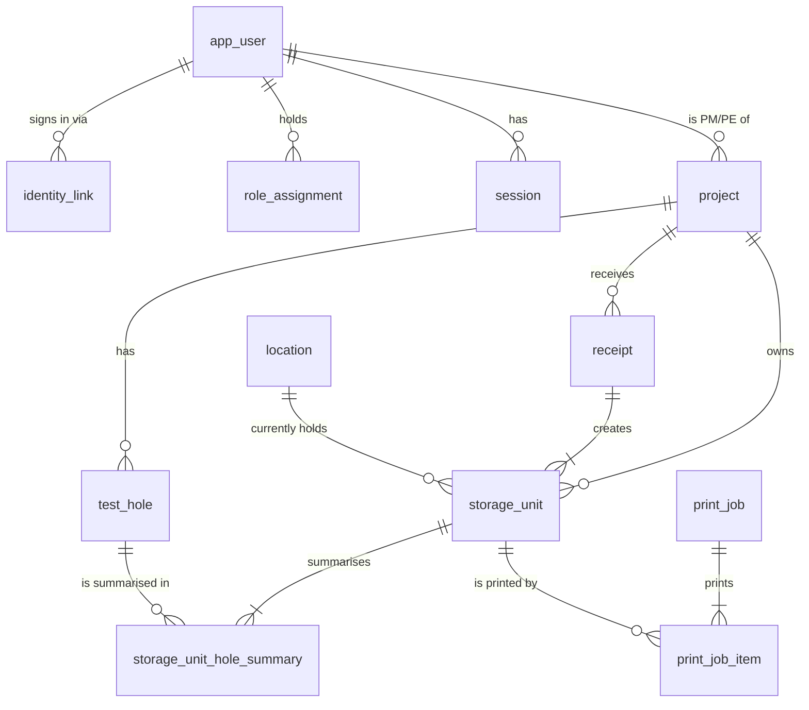

# Database

PostgreSQL 17, one database per environment (`materialmule_dev`, `materialmule_test`, production).
Schema changes live in `apps/api/migrations/NNNN_snake_name.sql` and are applied by the small
runner in `apps/api/src/db/migrator.ts` (MM-T02).

## Commands

| Command                 | What it does                                                                                              |
| ----------------------- | --------------------------------------------------------------------------------------------------------- |
| `npm run db:migrate`    | Apply pending migrations, then load reference data (Receiving lab)                                        |
| `npm run db:seed:dev`   | Load fictional fixtures (DEMO-2601, TH26-01/02, 7 test identities, 2 pending applicants). Refused in prod |
| `npm run db:reset:test` | Drop and rebuild the test database from `.env.test` (APP_ENV=test only)                                   |

In production, run the compiled CLI instead: `node apps/api/dist/db/cli.js migrate`.

## Migration rules

- Forward-only. Never edit a migration after it has been applied anywhere: the runner stores a
  SHA-256 of each file and refuses to run if an applied file changed. Write a new migration.
- Each migration runs in one transaction; a failure leaves no partial schema.
- A PostgreSQL advisory lock stops two migrators racing on the same database.
- Put integrity rules in the database (foreign keys, `CHECK`, unique indexes), then prove each one
  with a test in `apps/api/src/db/schema.test.ts`.
- Enumerations are `text` + `CHECK`, not PostgreSQL enum types, so they can be extended in a
  later migration without `ALTER TYPE`.

## Roles

- **Development and test:** one login (`materialmule`) owns both databases and runs migrations.
- **Production (MM-T20):** a migration role (`materialmule_owner`) owns the schema and every table
  and is used only by the deploy script; the API connects as `materialmule_app`, which can read and
  write rows but not create, alter or drop anything, not touch `schema_migration`, and only insert
  into `audit_event`. Neither role is a superuser. `node apps/api/dist/db/cli.js setup-roles
<migration-role> <app-role>` (as `postgres`, via `DATABASE_ADMIN_URL`) creates and grants them;
  it is idempotent. Proven in `apps/api/src/db/roles.test.ts` (runs where the test database user
  is a superuser, as in CI). Steps: [operations runbook](operations/runbook.md).

## Tests

Database tests read `TEST_DATABASE_URL` (falling back to `DATABASE_URL` in `apps/api/.env.test`).
Each test file creates its own temporary schema (`test_<random>`), migrates it and drops it
afterwards, so files run in parallel without sharing data.

## Schema (MM-T02)

Key rules enforced by the database:

- **One project per storage unit (D12).** `storage_unit_hole_summary` references both
  `storage_unit (project_id, id)` and `test_hole (project_id, id)` with the same `project_id`, so a
  summary can't join a unit to another project's test hole.
- **One summary per test hole per unit**, each shaped by type: ALL (no fields), sample range
  (from + to), depth range (from ≤ to, both ≥ 0, unit `ft` or `m`, stored as `numeric(8,2)`),
  Custom (non-blank text).
- **Storage unit IDs** match `^(CT|BKT|ST|CRE)-YYYY-NNNNNN$`. The prefix must match the physical
  holder at issue (`BKT` bucket, `ST` Shelby tube, `CRE` core box, `CT` generic), and the year
  must match `issued_year`. A trigger makes `readable_id`, `id_prefix`, `issued_year` and
  `issued_holder_kind` immutable; current `unit_type` / `holder_kind` stay correctable (D45).
- **Counters:** `storage_unit_annual_counter` has one row per prefix and year, capped at 999,999.
  `allocateStorageUnitIds` (`apps/api/src/numbering`) increments it inside the caller's
  transaction, so concurrent receipts serialise on the row and a rollback returns the numbers.
  The year is the confirmation date in `BUSINESS_TIME_ZONE` (America/Edmonton), never the
  received date. Note: tzdata 2026c has Edmonton on UTC−6 all year.
- **Issued IDs are never reused (migration 0020, MM-T47).** Triggers, which also bind the table
  owner, refuse `DELETE` and `TRUNCATE` on `storage_unit` (units leave through `status`, never by
  deletion) and on `storage_unit_annual_counter`, and any `UPDATE` that lowers a counter's
  `last_value` or moves it to another prefix or year. Raising a counter is allowed (e.g. after a
  restore). Errors use SQLSTATE `23001` (`restrict_violation`) and name the unit or counter. A
  receipt that issued units can't be deleted either (foreign key from `storage_unit`). Hole
  summaries carry no ID, so corrections may still replace them. Test and dev resets drop and
  recreate the schema (`db:reset:test`, `createMigratedSchema`), never delete rows; a test that
  needs fresh counters uses its own scratch schema.
- **Audit events are append-only** (migration 0002): triggers reject `UPDATE`, `DELETE` and
  `TRUNCATE` even for the table owner. Record events with `recordAudit` (`apps/api/src/audit`)
  on the same transaction client as the change; actor initials and name are snapshots.
- **Audit receivers are snapshots too (migration 0025, MM-T56).** An event that credits a
  receiver (receipts, LAB-station prints, project and test-hole creation) stores
  `receiver_initials_snapshot` and `receiver_name_snapshot` next to `receiver_user_id`. A
  `NOT VALID` check refuses any new event with a receiver but no name snapshot, or snapshots
  without a receiver; initials may be NULL for staff without confirmed initials. Older events
  can't be backfilled (append-only), so storage unit history reads the event snapshot, then the
  unit's receipt snapshot when the event credits the receipt's receiver, and only then the live
  user.
- **Print job people are snapshots (migration 0026, MM-T65).** A job stores the requester
  (`requested_by_*_snapshot`) and any receiver it credits (`receiver_*_snapshot`, a print at a LAB
  station) as of the request, and whoever confirmed the labels came out (`confirmed_by_*_snapshot`)
  as of the confirmation (Kyle, 2026-10-27). The migration filled older jobs from their audit
  events (print requested, physically confirmed), and the receiver also from a unit's receipt
  when the job credits the receipt's receiver; jobs with neither stay NULL and print history shows
  the live user for them. A trigger refuses a new job, a new or changed receiver, or a new
  confirmation without the person's name snapshot, and refuses clearing one (a CHECK couldn't
  spare the older rows, which still change status); a CHECK refuses snapshots without the person.
- **Project numbers and test-hole names** are stored trimmed and unique ignoring case (test holes
  per project only). Creates rely on those unique indexes (`INSERT … ON CONFLICT DO NOTHING`),
  so of two parallel creates exactly one succeeds and the other gets 409 with the existing row
  (MM-T08). Migration 0005 adds `text_pattern_ops` indexes for prefix search.
- **Receipts** hold 1–50 storage units (owner decision 2026-10-25). Each unit records its
  `receipt_line` (1 = first submitted, unique per receipt, migration 0003) so a retried
  confirmation returns the same row-to-ID mapping.
- **Receiving lab** is a system location and can't be deactivated.
- No individual sample table: receiving is per storage unit.
- **LAB credentials (migration 0004, MM-T06).** `local_credential` holds one Argon2id PHC string
  per account (the string records its own cost); a trigger allows it only for `shared_lab`
  accounts. `sign_in_throttle` counts failed local sign-ins per account and per client address.
  Reference data seeds the LAB account (`app_user` 00000000-0000-4000-8000-000000000001 with a
  `local_lab` identity, subject `LAB`) without a password: an admin sets it in
  Settings → Staff & access. LAB sign-in and the LAB password reset each start by taking
  `FOR NO KEY UPDATE` on LAB's `app_user` row, then read the hash in a new statement, then lock
  `sign_in_throttle` rows (MM-T40). That lock order serialises "verify password, create session"
  with "replace password, revoke sessions", so no old-password session outlives a reset.
- **Staff (migration 0008, MM-T07).** Official initials are not unique. `expected_upn` (an
  admin's pre-provisioned work email) is unique ignoring case when set; `approved_by` and
  `approved_at` are set together; `disabled_reason` exists only on a disabled account. Receipts
  keep receiver ID + initials + name snapshots, so renaming or disabling someone never rewrites
  history.

## Print queue (MM-T15, migration 0006)

- **Printers** (`printer`) are server-side configuration: key, name, host (IPv4 or host name),
  port (9100), enabled, default (at most one), status check. Print requests may only name a
  configured, enabled printer key; a host or port in a request is rejected. `LABEL_PRINTER_HOST`
  creates the `receiving` printer the first time the API starts with it set; afterwards an admin
  changes printers at `PUT /api/admin/printers` (Settings → Printers). Printers are never
  deleted (jobs reference them); turn one off instead.
- **Jobs** (`print_job` + `print_job_item` in print order) record kind (initial / reprint),
  template version, requesting account and, for the shared LAB account, the staff receiver.
- **Status rules** (worker in `apps/api/src/printing`, running inside the API process, one job
  at a time per printer, oldest first):
  - nothing sent (refused, timed out, host status reports paper out / head open / paused) →
    back to `queued` with backoff (5 s, 10 s), `failed` after 3 attempts;
  - every byte written and the connection closed cleanly → `sent`;
  - anything after label bytes started (drop mid-stream, no clean close) → `uncertain`, never
    resent automatically; a person reprints or marks it printed.
  - On startup, any job still `sending` becomes `uncertain` (the process stopped mid-send).
- `physically_confirmed_at` / `_by_user_id` record "Labels came out OK"; only allowed on `sent`
  or `uncertain` jobs. The UI never says "printed" without it.
- Printing never changes receipts, storage units or locations. Audit events:
  `label.print_requested`, `label.reprint_requested`, `label.print_failed`,
  `label.print_uncertain`, `label.physically_confirmed`, `printer.configured`.

## Receipt confirmation (MM-T09)

`POST /api/receipts` (`apps/api/src/receiving`) creates a receipt and its storage units in one
`READ COMMITTED` transaction:

1. Look up the `idempotency_key`. If it exists, compare the stored `request_hash` (SHA-256 of the
   validated payload with keys sorted, key excluded): equal → return the original result (200),
   different → 409 `idempotency_key_reused`. Nothing is written either way.
2. Validate what the shared zod schema can't: project exists, receiver is an active staff member
   with initials (never LAB), received date not after today in `BUSINESS_TIME_ZONE`, at most
   `RECEIPT_MAX_UNITS` units (400 `validation_failed` with `{field, code, message}` errors), and
   every test hole belongs to the project (422 `test_hole_not_in_project`).
3. Insert the receipt with `ON CONFLICT (idempotency_key) DO NOTHING`. A concurrent request with
   the same key waits on the unique index until the first commits, then finds its row and replays.
4. Allocate typed IDs (`allocateStorageUnitIds`, one block per holder kind, in submitted order),
   insert units at Receiving lab (`in_stock`) and their hole summaries, and audit
   `receipt.confirmed` plus one `storage_unit.created` per unit, all on the same client.

`READ COMMITTED` is enough: ID allocation serialises on the counter row lock held until commit,
the key is a unique constraint, the rows validated (project, test hole, user) aren't changed by
receipts, and the foreign keys re-check them at insert. Any error rolls back everything, including
the counter increment. The receipt stores the signed-in account (`account_user_id`, e.g. LAB) and
the selected receiver with initials and name snapshots. Printing is not part of confirmation
(MM-T15).

## Inventory search (MM-T12, migration 0010)

`GET /api/inventory` (`apps/api/src/inventory`) returns one row per storage unit, filtered,
sorted and paged on the server (default 25, max 100, with the total).

- **Search document.** `storage_unit_search` holds one lower-cased, newline-separated document per
  unit: ID, type, unit note, project number / name / client, each test-hole name with its
  SAMPLE#/DEPTH summary (Custom text and summary notes included) and the saved location's code and
  name. Each hole also appears as the app displays it ("th26-01: g1-s10", "th26-02: 3-5 ft"), and
  every dash (en/em dash, minus sign, Unicode hyphens) is folded to "-" in the document and in the
  search words (`splitInventorySearch`), so a summary copied from the table matches whichever dash
  it holds (MM-T59, migration 0027; MM-T36 builds on that definition). Triggers on `storage_unit`, `storage_unit_hole_summary`, `project`, `test_hole` and
  `location` rebuild it in the same transaction as the change, so it is never stale. Each search
  word becomes `document LIKE '%word%'` (AND across words, wildcards escaped), backed by a
  `pg_trgm` GIN index. `pg_trgm` is a trusted extension created in `public`; the migration role
  needs `CREATE` on the database (the owner has it). MM-T19 benchmarked it at ten-year and 5x
  volume; no index change was needed ([docs/performance](performance/README.md)).
- **Default view** "Current stock" excludes `disposed`; `status=all` or `status=disposed` show them.
- **Stable paging.** Sorting by received date always ends with the storage unit ID
  (`COLLATE "C"`), so equal dates never make pages overlap or skip rows.
- **Lookup.** `GET /api/storage-units/lookup?code=` trims and upper-cases, then matches the
  readable ID exactly (404 `storage_unit_not_found`). Scanning (T16/T17) reuses it.
- **Detail and history.** `GET /api/storage-units/:suNumber` (readable ID or UUID) and
  `GET /api/storage-units/:id/history?page=` (20 per page, newest first: the unit's audit events
  plus its receipt's confirmation). All read-only, `inventory.read` (LAB included).

## Storage unit corrections (MM-T13)

`PATCH /api/storage-units/:id` (`apps/api/src/storage-units/corrections`, readable ID or UUID)
corrects a confirmed unit's type, received date, project, test holes and summaries, and note
(D45–D47) with `{version, reason, changes}`. Personal and test accounts only
(`storage_unit.correct`); LAB gets 403. No migration: the schema already allows it.

- **Never changed:** the readable ID, prefix, issue year and issued holder (the identity trigger
  refuses them), the saved location, print history and the receipt header (`receipt.received_date`,
  `project_id`, receiver snapshots). `changes` is a strict object, so any other key is a 400.
- **One transaction per save:** `SELECT … FOR UPDATE` on the unit, compare `version` (stale →
  409 `version_conflict`), validate (received date not after today; holes must belong to the
  unit's new project, 422 `test_hole_not_in_project`; same summary rules as receiving), refuse a
  save that changes nothing (400 `no_changes`), then update the unit, replace its summaries as a
  set (deleted before a project change because they reference `(project_id, storage_unit_id)`),
  bump `version` and append one `storage_unit.corrected` audit event whose `before` / `after`
  hold only the changed fields, with the reason.
- **Project changes** ask the `LabRequestLinkChecker` first; unresolved links → 409
  `unresolved_lab_links {links}`. Until lab requests exist (MM-T23) the checker returns none.
- **Retention:** the detail shows `minimumRetainUntil` = current received date + 1 year (29 Feb →
  28 Feb). Full retention rules arrive with MM-T29.

## Projects list and detail (MM-T35, migration 0015)

`GET /api/projects` and `GET /api/projects/:id` (`apps/api/src/projects`) back the Projects
screens. Counts (test holes, in-stock units, last receipt date, units per hole and per receipt)
are computed by query, never stored.

- **Search** matches project number, name or client (contains, ignoring case, wildcards escaped),
  backed by `pg_trgm` GIN indexes on each. "Only mine" (`mine=true`) keeps projects where the user
  is `pm_pe_user_id` or `review_engineer_user_id`, both indexed.
- **Stable paging.** Every sort (number, name, last receipt with never-received projects last)
  ends with the normalised number (`COLLATE "C"`) and the ID. Default 25 per page, max 100.
- **Project number lock.** A trigger rejects changing `project_number` once the project has any
  receipt (it is printed on labels); the API answers 422 `project_number_locked` first.
- **Edits** bump `project.version` (optimistic concurrency) and record `project.updated` with only
  the changed fields before/after and the reason.

## Draft auto-delete setting (MM-T45, migration 0019)

`draft_auto_delete_setting` holds exactly one row (primary key `singleton`, which can only be
`true`): `enabled` (default `false`), `after_days` (30–365, default 90, a CHECK constraint),
`version`, `updated_at` and `updated_by_user_id`. Receiving drafts themselves stay in each browser
(MM-T11); browsers read this row through `GET /api/settings/drafts` and delete their own old
drafts when it is on. `PUT /api/settings/drafts` locks the row, compares `version` (stale → 409
`version_conflict` with the current value), bumps it and records `settings.drafts_changed`
(entity type `app_setting`, before/after, actor) in the same transaction. Saving the same values
again changes nothing.

## Staff position and official initials (MM-T43, MM-T44, migration 0024)

- **Position.** `position_set_at` records the person's first-login choice; the CHECK
  `app_user_position_set_has_position` needs a position whenever it is set. When an admin sets a
  position to Not set (`PATCH /api/staff/:id` with `position: null`), both are cleared in the same
  statement, so `GET /api/me` reports `positionSetupRequired` again and the person chooses a
  position at their next sign-in or page load. `staff.profile_changed` records the old position
  and `positionSetAt`. A non-null position leaves `position_set_at` unchanged.
- **Official initials.** Initials assigned by an admin are confirmed by that admin:
  `POST /api/staff` and a `PATCH` that changes `officialInitials` (or submits the same value while
  it is unconfirmed, audited as `staff.initials_confirmed`) write `initials_confirmed_by_user_id`
  and `initials_confirmed_at` in the same transaction. Edits that omit initials, resubmitting
  already-confirmed initials and Microsoft profile refreshes never change the pair.
- **Migration 0024** recovers the pair for rows the earlier code left unconfirmed, only from the
  audit trail: the latest `staff.preprovisioned` / `staff.initials_changed` event for the person,
  by a named person, that set exactly the current value. Other rows stay unconfirmed until an
  admin uses Confirm initials in Staff & access.

## Storage locations and location labels (MM-T37, migration 0028)

- **Location record.** `location` gains an optional `area` (trimmed, 1–60), `retired_at` and
  `retired_reason` (present exactly when `active` is false), `updated_at` and `version`
  (optimistic edits). Codes stay unique ignoring case through `code_normalized` (migration 0001).
  Locations made inactive before 0028 got a placeholder retirement so the pairing rule holds.
- **Guards (trigger `location_guard`).** Locations are never deleted; `is_system` never changes;
  the system location's kind never changes; once `code_locked_at` is set the code and the lock are
  fixed; the first `label_printed_at` is never moved. A CHECK keeps `label_printed_at` only on a
  code-locked location.
- **Code lock vs physical print.** `code_locked_at` is set in the transaction that queues the
  location's first label (under `SELECT … FOR UPDATE` on the location, the same lock edits take),
  so a queued, sending or uncertain label always carries the location's lasting code.
  `label_printed_at` is set only when a person confirms a location label job physically printed.
- **No units in a retired location.** A trigger on `storage_unit` inserts and
  `current_location_id` changes locks the destination row `FOR KEY SHARE` and refuses an
  inactive one (`storage_unit_location_active`). Retirement locks the row `FOR UPDATE` before
  counting occupants (units not `disposed`), so a retirement and an incoming unit serialise: the
  move waits and is refused, or the retirement waits and sees the unit (proved in
  `schema.test.ts`). MM-T28 moves rely on this contract.
- **Print queue targets.** `print_job.target_type` is `storage_unit` (default; `print_job_item`,
  unchanged) or `location` (`print_job_location_item` with the code and name as requested). Item
  triggers keep each item table on jobs of its own type and require a location label to carry the
  location's locked code; the target type never changes. The worker, retries, uncertain outcomes,
  claim/settlement recovery and physical confirmation are shared by both targets; location jobs
  render template `location-v1` from the snapshots. No storage unit or receipt stands in for a
  location.

## Shelby tubes, sampling sources and bulk groups (MM-T36, migration 0029)

Receiving increment only. Tested-unit removal ("Disposed after testing") is **not** in 0029: it
needs exact-unit completion evidence from MM-T23/T24 first.

- **Sampling source vs storage location.** A Shelby tube's source (`storage_unit.source_type`:
  `test_hole` with `source_test_hole_id`, or `standalone_location` with a nonblank free-text
  `source_location_reference`) is where the material came from; `current_location_id` is where the
  unit is now. There is no table of standalone locations and equal text never merges sources (owner
  decision 2026-10-27). Optional `sample_reference` and `sample_depth_from`/`_to`/`_unit` complete a
  tube's identity. The source hole FK carries `project_id`, so it is always the unit's project.
- **Bulk groups.** `bulk_group` holds a bulk sample's identity once: project, source (same two
  kinds, hole FK project-scoped), required `sample_reference` (usually B1, never forced or
  unique), required `depth_from` + `depth_unit`, optional `depth_to` and `description`, `version`
  (bumped by identity corrections), creator, and the creating receipt + its request key (so a retry
  returns the same group IDs). IDs are random UUIDs: no group letters. The project never changes.
- **Members.** A bulk soil bucket is `unit_type = 'bulk_container'`, `holder_kind = 'bucket'`,
  BKT- ID, with `bulk_group_id` (FK carries `project_id`). `storage_unit_contents_by_type_check`:
  ordinary buckets have neither source nor group; Shelby tubes may have a source (tubes from before
  0029 may not) and never a group; bulk buckets always have a group and no own source; generic CT
  `bulk_container` units (separate rules) have neither. "Bucket n of N" is computed when read
  (received date, then readable ID) and never stored.
- **One contents summary.** Triggers refuse hole summaries on a unit with a source or a group,
  and refuse giving a source or group to a unit that has hole summaries
  (`storage_unit_one_contents_summary`).
- **Search.** `storage_unit_search_document` is redefined from 0027's version (all 0027 forms and
  the dash folding kept) to add the source name, sample reference, depth (separate ends and
  joined), the group description, "bulk soil sample", and the identity as displayed
  ("th26-21: b1 at 1.5-2 m"). Triggers now also refresh a unit when its source, sample or group
  changes, every member when its group's identity changes, and tubes/bulk buckets when their source
  hole is renamed. 0029 rebuilds every document.
- **Sticker origin.** `storage_unit_origin_names(unit_id)` gives the existing origin line: hole
  names, a tube's source, or a bulk group's source. The label preview and the print worker both
  use it; sample references, depths, group IDs and bucket counts never reach the sticker.
- **Concurrency.** A receipt joining a group reads it `FOR SHARE` and names the identity version it
  showed (422 `bulk_group_changed` otherwise); an identity correction takes `FOR UPDATE`, so the two
  serialise. Concurrent joins don't block each other.

## Storage moves and location conflicts (MM-T28, migration 0035)

- **Tables.** `movement_event` keeps every move the server accepted: `move` (saved location
  changed, or confirmed in place), `contested` (held because the unit changed after the scan) and
  `resolution` (a person confirmed the actual location). It stores from/to locations, the base and
  resulting versions, the saving account (from the session) with snapshots, the LAB "Moved by"
  person with snapshots, the browser's station ID (random per browser profile; not a session or
  token), the device's reported `scanned_at` and the server's `saved_at`. `location_conflict`
  holds one open conflict per unit (partial unique index) with a `version` that goes up as
  attempts join it, then its single resolution. `move_action` is the idempotency record of each
  client intent (`client_move_id`): saving account, station, request hash, predecessor, and the
  outcome (`saved` or `conflict`) a retry is answered with. All three are append-or-settle:
  triggers refuse updates and deletes of events and actions, and a conflict changes only from
  open to resolved, once. A disposed unit's location can never change
  (`storage_unit_disposed_stays_put`).
- **Lock order.** `storage_unit` `FOR UPDATE` → destination `location` `FOR KEY SHARE` →
  `location_conflict` `FOR UPDATE`. Corrections (T13) and bulk-group changes (T36) take the unit
  lock first too; location retirement (T37) locks only the location `FOR UPDATE`, so a move and a
  retirement serialise on the location row without deadlock (the move sees the retirement → 422
  `location_retired`, or the retirement counts the unit → 409 `location_occupied`). A removal or
  disposal that holds the unit lock is seen by the waiting move (422 `storage_unit_disposed`).
- **Versions.** `storage_unit.version` is the general version (corrections bump it too). A move
  applies only when the unit still has the scan's base version (or, for a move linked to an
  earlier queued move of the same unit, account and station, that move's resulting version);
  otherwise, or while a conflict is open, it becomes a contested attempt. Never decided by scan
  time, never rebased. A scan at the unit's own saved location confirms it there without a new
  version. A resolution always bumps the version.
- **Idempotency.** The first delivery of an ID inserts its `move_action` in the same transaction
  as the event, location/version change, conflict and audit; a concurrent second delivery waits
  on the unit lock, then replays the recorded outcome (200, or 409 with the same conflict IDs). A
  conflict is a committed outcome, not a rolled-back error. Another account using a committed ID,
  or the same ID with a different intent, gets 409 `idempotency_key_reused` and learns nothing.
- **Tests.** `apps/api/src/moves/moves.integration.test.ts` races requests behind a row lock held
  on a separate connection, releasing it once `pg_stat_activity` shows every request waiting.

## Lab test catalogue and testing programs (MM-T23, migration 0030)

- **Catalogue:** `test_group` → `test_subgroup` (optional) → `test_type`. A test keeps its exact
  `code` (unique, case and punctuation preserved), full `description` and optional concise `name`
  as separate fields; its subgroup must belong to its group (composite FK). Groups, subgroups,
  tests and templates are never deleted (trigger): tests and templates are retired/restored
  (`active` ⇔ `retired_at IS NULL`), groups renamed. No costs are stored anywhere.
- **Reference data:** `seed/reference.sql` adds the Soils and Advanced Soils groups and the empty
  "Geotechnical – VI + Moisture Content" template with fixed IDs (`ON CONFLICT DO NOTHING`, so a
  rename is never undone). Test entries are **not** seeded until the owner's workbook rows are
  extracted and reconciled.
- **Programs:** `lab_program` (draft → submitted → closed; never back to draft; draft can't be
  closed), `program_number` `LP-YYYY-NNNN` issued at submission from `lab_program_counter`
  (business-time-zone year). Creator account and Requested by person (with snapshots) are kept
  separately, as are submitting account and person.
- **Lines:** `test_line` names one source explicitly (`source_kind` test_hole /
  standalone_unit / standalone_bulk_group, with the matching same-project FK) and a scope (all,
  grabs, spt, specific). Draft tests are in `test_line_test`, explicit unit choices in
  `test_line_unit_choice`. Lines and their children can change only while the program is a draft.
- **Submission** (one transaction) freezes `program_scope_snapshot` (unit, receipt, project,
  included, `matching_basis`, display snapshots), the line's `source_display_snapshot`, and
  `test_request` rows with catalogue snapshots. Snapshots are append-only and accepted only while
  the program is still a draft, i.e. inside the submission; requests are never deleted and their
  snapshots never change. A trigger refuses submission of an incomplete program.
- **Grabs/SPT:** units have no structured G/S classification, so every candidate is frozen as
  `reviewed_included` (explicitly chosen) or `unknown_classification_excluded`.
- **Link checker (T13/D47):** `ProgramLabRequestLinks` lists programs that aren't closed and
  include the unit in frozen coverage, a draft unit choice or a standalone source; a project
  correction is refused while any exist. Submission takes `FOR SHARE` on the units it freezes.
