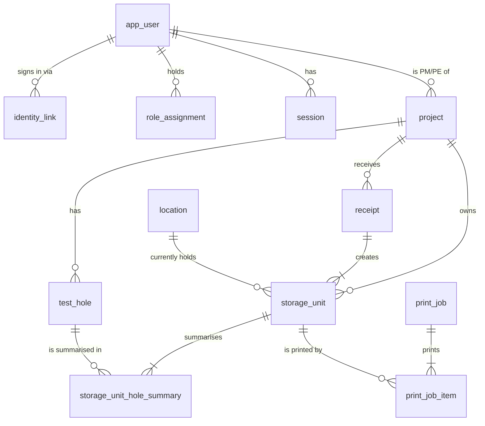

# Database

PostgreSQL 17, one database per environment (`trapezoid_dev`, `trapezoid_test`, production).
Schema changes live in `apps/api/migrations/NNNN_snake_name.sql` and are applied by the small
runner in `apps/api/src/db/migrator.ts` (TRP-T02).

## Commands

| Command                 | What it does                                                                |
| ----------------------- | --------------------------------------------------------------------------- |
| `npm run db:migrate`    | Apply pending migrations, then load reference data (Receiving lab)          |
| `npm run db:seed:dev`   | Load fictional fixtures (DEMO-2601, TH26-01/02, two staff). Refused in prod |
| `npm run db:reset:test` | Drop and rebuild the test database from `.env.test` (APP_ENV=test only)     |

In production, run the compiled CLI instead: `node apps/api/dist/db/cli.js migrate`.

## Migration rules

- Forward-only. Never edit a migration after it has been applied anywhere: the runner stores a
  SHA-256 of each file and refuses to run if an applied file changed. Write a new migration.
- Each migration runs in one transaction; a failure leaves no partial schema.
- A PostgreSQL advisory lock stops two migrators racing on the same database.
- Put integrity rules in the database (foreign keys, `CHECK`, unique indexes), then prove each one
  with a test in `apps/api/src/db/schema.test.ts`.
- Enumerations are `text` + `CHECK`, not PostgreSQL enum types, so they can be extended in a
  later migration without `ALTER TYPE`.

## Roles

- **Development and test:** one login (`trapezoid`) owns both databases and runs migrations.
- **Production (TRP-T20):** a migration role owns the schema; the API connects with a separate
  role that has only the data privileges it needs and no superuser rights. TRP-T03 removes
  `UPDATE`/`DELETE` on `audit_event` from the API role.

## Tests

Database tests read `TEST_DATABASE_URL` (falling back to `DATABASE_URL` in `apps/api/.env.test`).
Each test file creates its own temporary schema (`test_<random>`), migrates it and drops it
afterwards, so files run in parallel without sharing data.

## Schema (TRP-T02)

Key rules enforced by the database:

- **One project per storage unit (D12).** `storage_unit_hole_summary` references both
  `storage_unit (project_id, id)` and `test_hole (project_id, id)` with the same `project_id`, so a
  summary can't join a unit to another project's test hole.
- **One summary per test hole per unit**, each shaped by type: ALL (no fields), sample range
  (from + to), depth range (from ≤ to, both ≥ 0, unit `ft` or `m`, stored as `numeric(8,2)`),
  Custom (non-blank text).
- **Storage unit IDs** match `^(CT|BKT|ST|CRE)-YYYY-NNNNNN$`. The prefix must match the physical
  holder at issue (`BKT` bucket, `ST` Shelby tube, `CRE` core box, `CT` generic), and the year
  must match `issued_year`. A trigger makes `readable_id`, `id_prefix`, `issued_year` and
  `issued_holder_kind` immutable; current `unit_type` / `holder_kind` stay correctable (D45).
- **Counters:** `storage_unit_annual_counter` has one row per prefix and year, capped at 999,999.
  `allocateStorageUnitIds` (`apps/api/src/numbering`) increments it inside the caller's
  transaction, so concurrent receipts serialise on the row and a rollback returns the numbers.
  The year is the confirmation date in `BUSINESS_TIME_ZONE` (America/Edmonton), never the
  received date. Note: tzdata 2026c has Edmonton on UTC−6 all year.
- **Audit events are append-only** (migration 0002): triggers reject `UPDATE`, `DELETE` and
  `TRUNCATE` even for the table owner. Record events with `recordAudit` (`apps/api/src/audit`)
  on the same transaction client as the change; actor initials and name are snapshots.
- **Project numbers and test-hole names** are stored trimmed and unique ignoring case (test holes
  per project only).
- **Receipts** hold 1–50 storage units (owner decision 2026-10-25). Each unit records its
  `receipt_line` (1 = first submitted, unique per receipt, migration 0003) so a retried
  confirmation returns the same row-to-ID mapping.
- **Receiving lab** is a system location and can't be deactivated.
- No individual sample table: receiving is per storage unit.
- **Staff (migration 0004, TRP-T07).** Official initials are not unique. `expected_upn` (an
  admin's pre-provisioned work email) is unique ignoring case when set; `approved_by` and
  `approved_at` are set together; `disabled_reason` exists only on a disabled account. Receipts
  keep receiver ID + initials + name snapshots, so renaming or disabling someone never rewrites
  history.

## Receipt confirmation (TRP-T09)

`POST /api/receipts` (`apps/api/src/receiving`) creates a receipt and its storage units in one
`READ COMMITTED` transaction:

1. Look up the `idempotency_key`. If it exists, compare the stored `request_hash` (SHA-256 of the
   validated payload with keys sorted, key excluded): equal → return the original result (200),
   different → 409 `idempotency_key_reused`. Nothing is written either way.
2. Validate what the shared zod schema can't: project exists, receiver is an active staff member
   with initials (never LAB), received date not after today in `BUSINESS_TIME_ZONE`, at most
   `RECEIPT_MAX_UNITS` units (400 `validation_failed` with `{field, code, message}` errors), and
   every test hole belongs to the project (422 `test_hole_not_in_project`).
3. Insert the receipt with `ON CONFLICT (idempotency_key) DO NOTHING`. A concurrent request with
   the same key waits on the unique index until the first commits, then finds its row and replays.
4. Allocate typed IDs (`allocateStorageUnitIds`, one block per holder kind, in submitted order),
   insert units at Receiving lab (`in_stock`) and their hole summaries, and audit
   `receipt.confirmed` plus one `storage_unit.created` per unit, all on the same client.

`READ COMMITTED` is enough: ID allocation serialises on the counter row lock held until commit,
the key is a unique constraint, the rows validated (project, test hole, user) aren't changed by
receipts, and the foreign keys re-check them at insert. Any error rolls back everything, including
the counter increment. The receipt stores the signed-in account (`account_user_id`, e.g. LAB) and
the selected receiver with initials and name snapshots. Printing is not part of confirmation
(TRP-T15).
